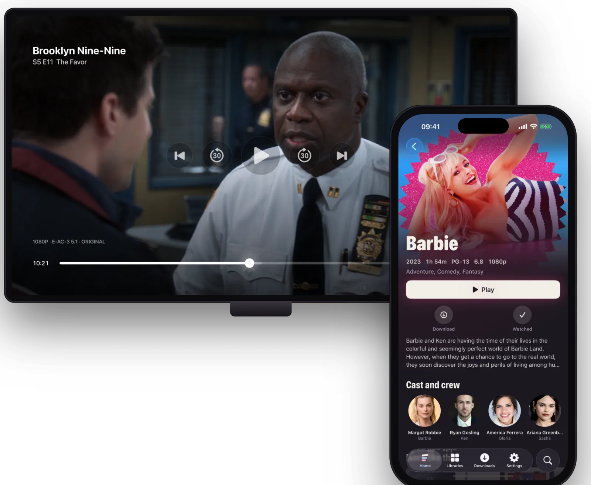
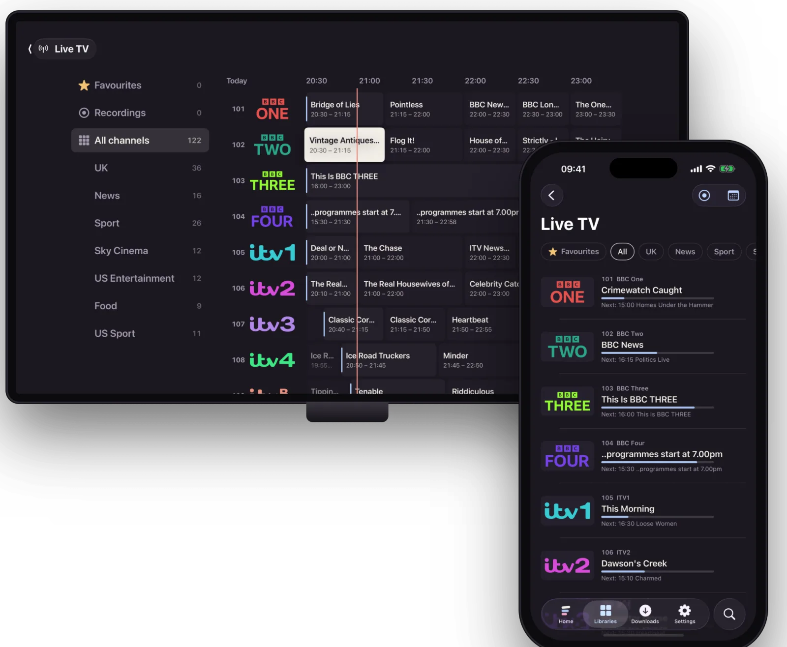

<p align="center">
  
</p>

<h1 align="center">Flexarr</h1>

<p align="center"><strong>Your entertainment. Every screen.</strong></p>

<p align="center">
  Your own streaming service for the films, TV, music and podcasts you already have.<br>
  Apple TV, iPhone, iPad and the web, with Android on the way. Built for <a href="https://sonarr.tv">Sonarr</a>, <a href="https://radarr.video">Radarr</a> and <a href="https://lidarr.audio">Lidarr</a>, and happy with plain folders too. No ads, no account, no subscription.
</p>

<p align="center">
  <a href="https://github.com/danleach-glitch/flexarr/releases"></a>
  <a href="https://github.com/danleach-glitch/flexarr/actions/workflows/ci.yml"></a>
  <a href="https://github.com/danleach-glitch/flexarr/pkgs/container/flexarr"></a>
  <a href="https://apps.apple.com/app/flexarr/id6826618084"></a>
  <a href="LICENSE"></a>
</p>

<p align="center">
  <a href="https://flexarr.io">flexarr.io</a> ·
  <a href="https://flexarr.io/guide">Guide</a> ·
  <a href="#-quick-start">Quick start</a> ·
  <a href="CHANGELOG.md">Changelog</a> ·
  <a href="docs/roadmap.md">Roadmap</a>
</p>

<p align="center">
  
</p>

Flexarr is a media server you run at home. It organises your library, takes artwork and details from the \*arr apps you already run (or from the `.nfo` files and artwork beside your files, and TVmaze), and plays to your screens: as the file is when the device can manage it, converted on the fly when it can't. There's no account and no cloud in the middle. It runs a real 12,000-file library every day; the [changelog](CHANGELOG.md) has what's new.

## ✨ What it does

| | |
| --- | --- |
| 🎬 **Its own player** on Apple TV, iPhone and iPad: skip intro and credits, Up Next, scrubbing previews | 🌈 **HDR10, HDR10+, HLG and Dolby Vision** reach the TV untouched; **Dolby Atmos** passes through intact |
| ⚡ **Plays files as they are** (AV1, VC-1, XviD and all), converting on the server only when it must | 📺 **Live TV and recording** with a full guide, pause and rewind, from your own tuner or IPTV service through Dispatcharr |
| 🎵 **Music** with synced lyrics, playlists, daily mixes, artist radio, gapless and crossfade | 🎙️ **Podcasts built in**: Apple's directory or any feed, chapters, Up Next across devices, OPML import |
| 👨‍👩‍👧 **Profiles** with their own history, libraries, watchlist and PINs | 🧒 **Kids profiles** with UK age limits (U to 18), any country's ratings counted, and a **child lock** that keeps them there |
| 🔖 **A watchlist** of films and shows to watch later, whether you have them yet or not | 🔊 **Dialogue boost and night mode**, on by themselves at night if you like, and stereo or 5.1 for your speakers |
| 💬 **Subtitles your way**: styled ones as made, placed where you like, and found through Bazarr when a file has none | 📱 **Your iPhone as the Apple TV's remote**, on the Lock Screen too, and **Continue on iPhone** to carry on from the sofa |
| 📥 **Downloads** of films, episodes, albums, playlists and podcasts on iPhone and iPad | 🌍 **Away from home over Tailscale**, no ports opened; the apps switch by themselves |
| 🗣️ **Siri and Shortcuts**: "Play the next episode of *Ted Lasso* in Flexarr", "Skip intro in Flexarr" | 🔔 **Notifications**, widgets and the Apple TV Top Shelf |
| 🔌 **Built on your \*arrs**: metadata from Sonarr, Radarr and Lidarr, requests through Seerr, no TMDB keys | 📁 **Or without them**: `.nfo` files and artwork from Kodi, Jellyfin or Plex folders, TVmaze for shows, TMDB with a free key |
| 🧭 **A setup guide** that finds the \*arrs on your network, adds their webhooks and turns their folders into libraries | 🏠 **[Home Assistant](https://github.com/danleach-glitch/flexarr-home-assistant)** and an **MCP server** for Claude or any assistant |
| 📼 **Home videos**: your own videos, arranged by folder and never looked up online | 🧰 **Looks after itself**: library health, Plex history import, backups, readable logs, one-click updates on a Mac |

<p align="center">
  
  
</p>

## 📱 Apps

- **iPhone and iPad:** [on the App Store](https://apps.apple.com/app/flexarr/id6826618084).
- **Apple TV:** with Apple for review. Until it's on the App Store, [install it from Xcode](https://flexarr.io/guide/apple-tv-xcode).
- **Web:** built into the server. Open its address in any browser, phones included.
- **Home Assistant:** [through HACS](https://github.com/danleach-glitch/flexarr-home-assistant).
- **In development:** Flexarr Server for Mac, a menu bar app for the Mac App Store; an app for Android phones and tablets (until then, the web works in your phone's browser); and one for Android TV and Google TV, laid out like the Apple TV app.

Every app, its status and version are on [flexarr.io/apps](https://flexarr.io/apps).

Each app connects with a short code you approve on your phone, or in **Settings › Access › Connect a device** on the web; see [Connect your devices](https://flexarr.io/guide/connect-devices).

## 🚀 Quick start

```bash
docker run -d --name flexarr --restart unless-stopped \
  -p 8383:8383 \
  -v flexarr-config:/config \
  -v /path/to/media:/data/media \
  ghcr.io/danleach-glitch/flexarr:latest
```

Open the link in the server's log (`docker logs flexarr`): it has the setup code filled in, so you only choose a PIN to protect the server's settings. A short guide then walks you through connecting Sonarr, Radarr and Lidarr (it finds them on your network and adds their webhooks), adding your libraries, everyone who watches, and your devices. Skip any of it and find it later in **Settings**. Flexarr usually works out where the \*arrs' folders are on its side by itself; if not, **Settings › Connections › Media folders** lets you choose them.

Step-by-step guides on [flexarr.io/guide](https://flexarr.io/guide):

- **Install:** [Linux and Windows (Docker)](https://flexarr.io/guide/install-docker) · [Synology](https://flexarr.io/guide/install-synology) · [Unraid](https://flexarr.io/guide/install-unraid) · [macOS, natively](https://flexarr.io/guide/install-macos)
- **Set up:** [First setup](https://flexarr.io/guide/first-setup) · [Connect your \*arrs](https://flexarr.io/guide/connect-arrs) · [Without Sonarr and Radarr](https://flexarr.io/guide/without-arrs) · [Media paths](https://flexarr.io/guide/media-paths) · [Away from home](https://flexarr.io/guide/away-from-home)
- **Help:** [Updating](https://flexarr.io/guide/updating) · [Troubleshooting](https://flexarr.io/guide/troubleshooting) · [FAQ](https://flexarr.io/guide/faq)

The guide's source is in [docs/guide](docs/guide); corrections are welcome.

## 🛠️ Development

Prerequisites: [.NET 10 SDK](https://dotnet.microsoft.com/download), Node.js 24+, FFmpeg 7+; for the Apple clients Xcode 26+ with [XcodeGen](https://github.com/yonaskolb/XcodeGen); for the Android app [Android Studio](https://developer.android.com/studio) (its JDK 17 and SDK).

```bash
make setup     # restore .NET + npm dependencies
make dev-api   # server on http://localhost:8383 (hot reload)
make dev-web   # web client on http://localhost:5173
make test      # server + web tests
make apple     # build the tvOS and iOS apps
make guide     # rebuild flexarr.io/guide from docs/guide
make apps      # rebuild flexarr.io/apps from site/apps.json
```

| Path | What |
| --- | --- |
| `src/Flexarr.Api` | ASP.NET Core server: REST API, playback sessions, live TV, podcast feeds, background workers |
| `src/Flexarr.Core` | Domain model, database, parsing, library scanning |
| `src/Flexarr.Metadata` | Metadata from Sonarr, Radarr, Lidarr, TVmaze, TMDB and local `.nfo` files and artwork, image cache |
| `src/Flexarr.Streaming` | Playback decisions, FFmpeg/HLS, subtitles, previews, intro/credits detection |
| `src/Flexarr.Integrations.Arr` | Sonarr, Radarr, Lidarr and Seerr clients and webhooks |
| `frontend/` | Web client (React, TypeScript, Vite) |
| `clients/apple/` | `FlexarrKit`, shared app code, and the tvOS and iOS apps |
| `clients/android/` | The Android app, for phones, tablets and Android TV (in development) |
| `clients/macos/` | Flexarr Server for Mac (in development): the server and web app as a sandboxed menu bar app |
| `site/` | flexarr.io, with the guide built into `site/guide` and the apps page into `site/apps.html` |
| `relay/` | The iPhone app's notification relay (push.flexarr.io) |

See [CONTRIBUTING.md](CONTRIBUTING.md) and [docs/architecture.md](docs/architecture.md). What's next is in the [roadmap](docs/roadmap.md).

## 📄 Licence

Flexarr is free to use, change and share for any noncommercial purpose under the [PolyForm Noncommercial License 1.0.0](LICENSE). That covers personal use, home servers, and charities, schools and other noncommercial organisations. You may not sell Flexarr, or use it in a commercial product or service, without a separate licence from the author.

Because it restricts commercial use, Flexarr is *source-available* rather than open source in the [OSI's sense](https://opensource.org/osd).

## 🙏 Acknowledgements

Flexarr is built on many other projects: the \*arr apps it works with, FFmpeg, AetherEngine and more. They're all credited, with their licences, in [ACKNOWLEDGEMENTS.md](ACKNOWLEDGEMENTS.md).
