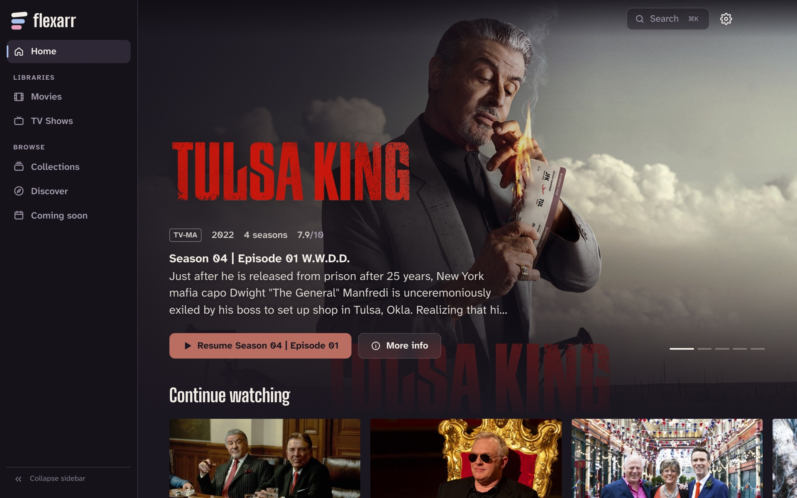
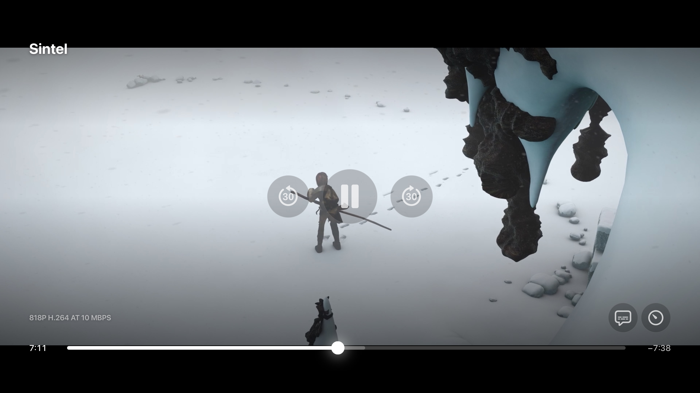
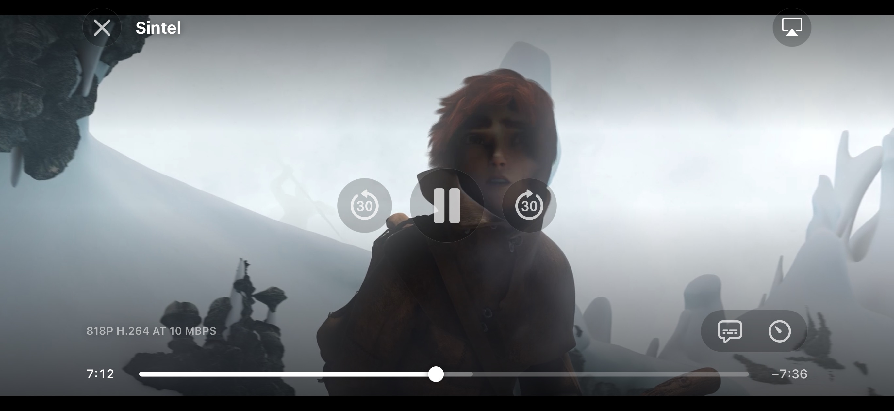
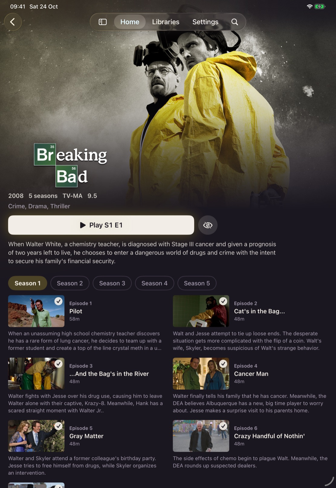
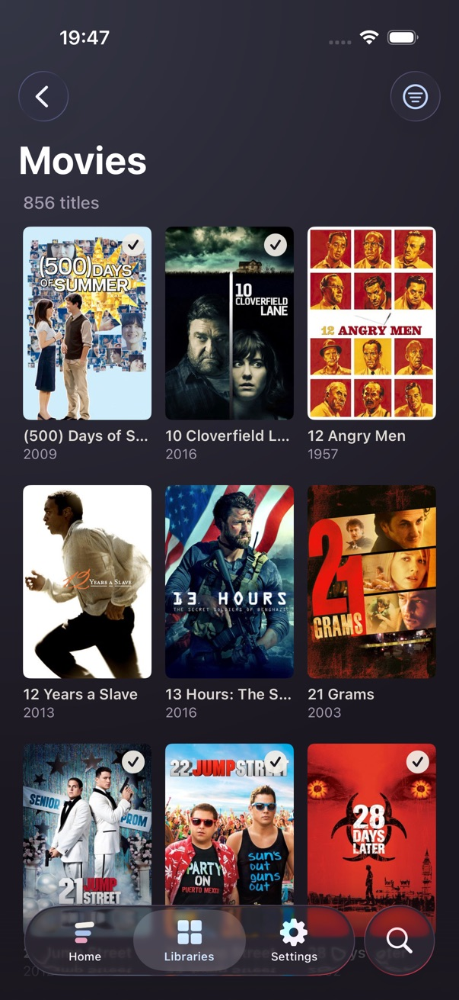

<p align="center">
  
</p>

<h1 align="center">Flexarr</h1>

<p align="center"><strong>Your entertainment. Every screen.</strong></p>

<p align="center">
  A free, open-source, self-hosted media server for your films, TV shows and music, built to sit alongside <a href="https://sonarr.tv">Sonarr</a>, <a href="https://radarr.video">Radarr</a> and <a href="https://lidarr.audio">Lidarr</a>.<br>
  Stream your library to the web, Apple TV, iPhone and iPad. No account. No cloud.
</p>

<p align="center">
  <a href="https://github.com/danleach-glitch/flexarr/releases"></a>
  <a href="https://github.com/danleach-glitch/flexarr/actions/workflows/ci.yml"></a>
  <a href="https://github.com/danleach-glitch/flexarr/pkgs/container/flexarr"></a>
  <a href="LICENSE"></a>
  
</p>

<p align="center">
  <a href="https://flexarr.io">flexarr.io</a> ·
  <a href="#quick-start-docker">Quick start</a> ·
  <a href="#apple-tv-iphone-and-ipad">Apple apps</a> ·
  <a href="CHANGELOG.md">Changelog</a> ·
  <a href="docs/roadmap.md">Roadmap</a>
</p>

<p align="center">
  
</p>

> **Status:** version 0.20.1, running a real 12,000-file library day to day. The web app and the Apple TV, iPhone and iPad apps are all first-class clients. See the [changelog](CHANGELOG.md) and the [roadmap](docs/roadmap.md).

## Why Flexarr

Flexarr is a media server you run yourself. It organises your library, fetches artwork and details, and plays to your screens, with direct play when the device can manage it and conversion on the fly when it can't. There is no account to make and no cloud in the middle: the server talks to your devices and nothing else. It is built for people who already run the \*arr stack, so Sonarr, Radarr, Lidarr and Seerr are where the metadata, the artwork and the requests come from rather than afterthoughts. And it is open source under the GPL, like the \*arrs themselves.

## What it does

### Library and metadata

- Films, TV and music libraries, scanned in minutes and kept current by Sonarr/Radarr/Lidarr webhooks, a 12-hour rescan and a rescan at startup
- Artwork, overviews, genres, ratings, trailers and cast taken from **your Sonarr and Radarr** (no TMDB or TVDB keys), with TVmaze for TV cast
- A design that takes its colour from whatever you're looking at ([design notes](docs/design.md)), readable from the sofa, keyboard-first, and fine on a phone

### Watching

<table>
<tr>
<td width="50%" valign="top">

- **Flexarr's own player** on Apple TV, iPhone and iPad: previous and next episode, skip back and forward, a timeline with the intro and credits shaded and preview thumbnails while scrubbing, and menus for audio, subtitles and playback speed, on clear glass that fades while you watch. On Apple TV, holding the remote's edge scans at 2× to 16×
- **Play files directly** (on by default on the Apple apps): an on-device engine plays each file as it is, every container and codec, AV1, VC-1 and XviD included, with HDR10, HLG and Dolby Vision untouched. The server does nothing but send bytes
- From the server, H.264 and HEVC files are repackaged rather than re-encoded, so **HDR10, HLG and Dolby Vision** reach an Apple TV as they are; everything else is converted as you watch with **hardware acceleration** (VideoToolbox on macOS; VA-API, Quick Sync and NVENC elsewhere), seeking anywhere instantly
- **Dolby Atmos** passes through intact; TrueHD, DTS-HD and PCM arrive as lossless FLAC up to 7.1, or as multichannel PCM over HDMI with Lossless surround on
- **Skip intro, recap and credits**, found by audio fingerprinting across each season (or from chapter names), each one a per-profile choice, plus **Up Next** with a countdown and the next episode ready before it's needed
- Subtitles (embedded and sidecar `.srt`/`.ass`/`.vtt`; picture subtitles drawn or burned in) with timing and size you can adjust, audio track and quality switching, resume everywhere, picture-in-picture and AirPlay

</td>
<td width="50%" valign="top">





</td>
</tr>
</table>

### Finding something

- Home: Continue Watching with Up Next, Top 10 films and shows, genre rows, "Because you watched", new arrivals per library
- ⌘K search across titles, episodes, people and genres; person pages; Discover by genre
- **Collections**: your own, smart ones that fill themselves from rules (e.g. *Top 10 shows this year*), and film series from Radarr, any of which can be a row on Home
- **Shuffle** a show: a random episode, then another, until you stop
- **Coming soon**: what Sonarr and Radarr expect this month, with download progress
- **Requests**: with Seerr connected, see what's trending that you don't have and request it in one click

### For the whole household

- Profiles with their own Continue Watching, history and Up Next, an optional PIN, and a profile picker when Flexarr opens, on the web and on Apple TV
- Choose which libraries each profile can see
- Each browser and device gets a sign-in of its own, which you can sign out from Settings; an Apple TV connects by scanning a QR code
- **Away from home over Tailscale**, with no ports opened on your router

### Music

- Artists and albums with their names, years, overviews and artwork from **Lidarr** (the artist's own picture, every album's cover), falling back to the tags and cover art in the files
- **Play** and **Shuffle** an artist's whole catalogue or an album, with a now-playing bar that keeps going while you browse, and media-key support
- **Lyrics** from tags and `.lrc` sidecars, synced to the song when they carry timestamps

### Things Plex doesn't do

- **Bring your history over from Plex**: watched state and resume points, matched by file, without touching Plex
- **Library health**: a health score, duplicate copies (and the space they use), unreadable files, standard-definition titles with a "find a better copy" button that asks Radarr/Sonarr, and titles whose match is worth checking
- **Fix match**: correct a wrongly matched film or show by picking the right one from Sonarr or Radarr, and it stays fixed
- **Delete** a film, show or episode from its page, through Sonarr and Radarr, or by Flexarr itself for titles they don't manage
- **Downloads** on iPhone and iPad for watching with no connection, prepared by your server when nobody's watching; the next episode downloads itself on Wi-Fi
- No account, no cloud, open source

## Apple TV, iPhone and iPad

<table>
<tr>
<td width="55%" valign="top">

The Apple apps (in `clients/apple`) are built for the sofa and the sofa's phone: Home with Continue Watching and the rows you've set up, your libraries, search, title pages with seasons and episodes, profiles with their PINs, and Flexarr's own player described above. Every setting follows the profile from device to device.

- **Apple TV:** Top Shelf shows Continue Watching from the Home screen, ready to play; the current profile sits in the tab bar; clicking the remote's edges skips 30 seconds and holding one scans
- **iPhone and iPad:** Picture in Picture, AirPlay and playing on with the screen locked; the lock screen, Control Center and a paired watch can play, pause and move between episodes; **Downloads** for offline watching
- Both find your server on the home network by themselves. Approve the code the app shows in **Settings › Connect a TV** on any signed-in device (on an iPhone, **Approve in Safari** opens it for you), or type the API key; either way the device gets a sign-in of its own rather than keeping the key.

**Getting them:** the iPhone and iPad app is on TestFlight and coming to the App Store. The Apple TV app, and either app before the store, installs from Xcode onto your own devices as below.

</td>
<td width="45%" valign="top">

<p align="center">
   
</p>

</td>
</tr>
</table>

For an Apple TV:

1. Sign Xcode in to your Apple ID (Xcode › Settings › Accounts). A free one works.
2. Pair the Apple TV: on the TV, open Settings › Remotes and Devices › Remote App and Devices; on the Mac, open Devices and Simulators (⇧⌘2) and pair it.
3. Run `make apple-install TEAM=<your team id> BUNDLE_ID=com.yourname.flexarr.tv`. Your team id is in Xcode › Settings › Accounts; the identifier just needs to be unique to you.

For an iPhone or iPad, connect it to the Mac (or pair it over Wi-Fi in Devices and Simulators), turn on Developer Mode on the device (Settings › Privacy & Security), then run `make ios-install TEAM=<your team id> BUNDLE_ID=com.yourname.flexarr.ios`.

With a free Apple ID the apps stop opening after 7 days; run the same command again.

## Quick start (Docker)

```bash
docker run -d --name flexarr \
  -p 8383:8383 \
  -v /path/to/config:/config \
  -v /path/to/media:/data/media \
  ghcr.io/danleach-glitch/flexarr:latest
```

`latest` is the newest release (each is listed under [Releases](https://github.com/danleach-glitch/flexarr/releases)); pin a version such as `0.20` or `0.20.1` to upgrade when you choose. Images are published for releases only. Install instructions are also at [flexarr.io](https://flexarr.io).

Open <http://localhost:8383>. On first run Flexarr generates an API key and saves it to `/config/config.json`. Sign in to the web app with it once; each browser and Apple TV then gets a sign-in of its own, listed in Settings › Server where you can sign any of them out.

Plain `http://` is fine on a home network you trust. From anywhere else, use Tailscale (Settings › Remote access) or an HTTPS reverse proxy, so the key and sign-ins aren't sent in the clear. A reverse proxy on another machine or in Docker must be listed in `trustedProxies`, or Flexarr treats everything it forwards as the internet.

Mount your media at the **same path** Sonarr/Radarr/Lidarr use, or add `pathMappings` to `config.json`, so the paths in their webhooks match what Flexarr sees.

### macOS (native)

On a Mac, run Flexarr natively so it can use hardware transcoding: `make deploy DEPLOY_HOST=<ssh-host>`. See [docs/install-macos.md](docs/install-macos.md).

## Connect Sonarr / Radarr / Lidarr / Seerr

Add each app in **Settings › Connections** with its address and API key: Sonarr and Radarr supply the metadata and artwork, Lidarr the music's, and Seerr the trending titles and requests. Then, so new downloads appear the moment they land, in each \*arr go to **Settings → Connect → + → Webhook** and set:

- **URL:** `http://<flexarr-host>:8383/api/v1/webhooks/sonarr?secret=<webhook-secret>` (use `radarr` / `lidarr` as appropriate). Settings › Server shows the addresses with the secret filled in.
- **Method:** POST
- **Triggers:** On Import, On Upgrade, On Rename, On Delete

Press **Test** — Flexarr answers with `200 OK`. See [docs/arr-integration.md](docs/arr-integration.md) for details.

## Repository layout

| Path | What |
| --- | --- |
| `src/Flexarr.Api` | ASP.NET Core server: REST API (`/api/v1`), playback sessions, background workers, serves the web client |
| `src/Flexarr.Core` | Domain model and database, filename and tag parsing, library scanning, ffprobe |
| `src/Flexarr.Metadata` | Metadata from Sonarr/Radarr/TVmaze, image cache, ambient colours |
| `src/Flexarr.Streaming` | Playback decisions, FFmpeg/HLS transcoding, subtitles, scrubbing previews, intro/credits detection |
| `src/Flexarr.Integrations.Arr` | Sonarr / Radarr / Lidarr / Seerr clients and webhook handling |
| `frontend/` | Web client (React + TypeScript + Vite) |
| `clients/apple/` | Apple clients: `FlexarrKit` (shared Swift package), `Shared/` app code, and the tvOS and iOS apps |
| `docs/` | Architecture, \*arr integration, roadmap |

## Development

Prerequisites: [.NET 10 SDK](https://dotnet.microsoft.com/download), Node.js 24+, FFmpeg 7+ (`ffmpeg` and `ffprobe` on the PATH), and for the Apple clients Xcode 26+ with [XcodeGen](https://github.com/yonaskolb/XcodeGen).

```bash
make setup     # restore .NET + npm dependencies
make dev-api   # server on http://localhost:8383 (hot reload)
make dev-web   # web client on http://localhost:5173 (proxies /api to the server)
make test      # server + web tests
make apple     # generate the Xcode project and build the tvOS and iOS apps
```

`docker compose up -d` starts Flexarr together with Sonarr, Radarr, Lidarr and Prowlarr for integration testing.

See [CONTRIBUTING.md](CONTRIBUTING.md) for conventions and [docs/architecture.md](docs/architecture.md) for how the pieces fit together.

## Roadmap

What's done and what's next is in [docs/roadmap.md](docs/roadmap.md); what changed in each version is in the [changelog](CHANGELOG.md).

## Licence

Flexarr is licensed under the [GNU GPL v3.0 or later](LICENSE), like Sonarr, Radarr and Lidarr. The on-device playback engine in the Apple apps is [AetherEngine](https://github.com/superuser404notfound/AetherEngine), under the LGPL.
