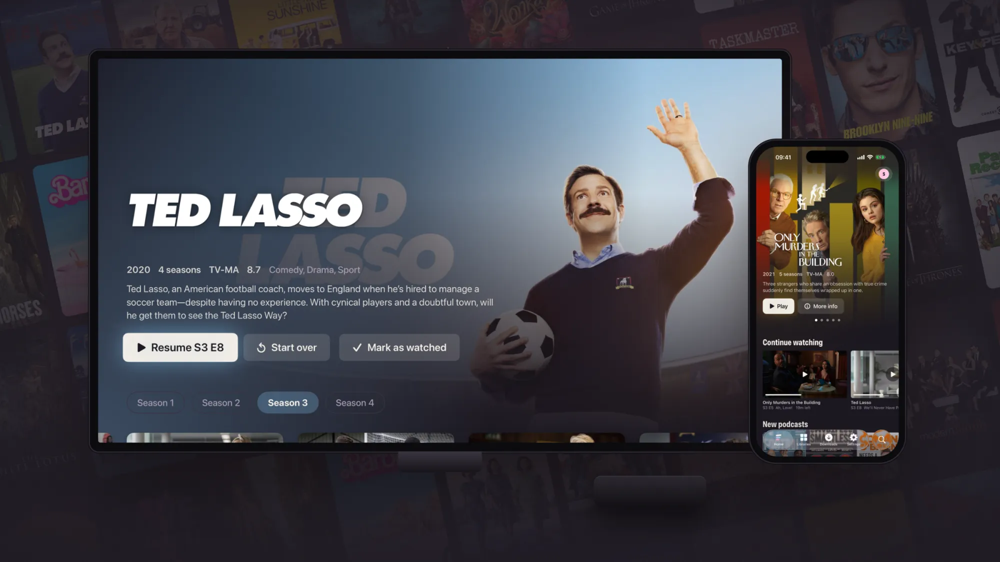
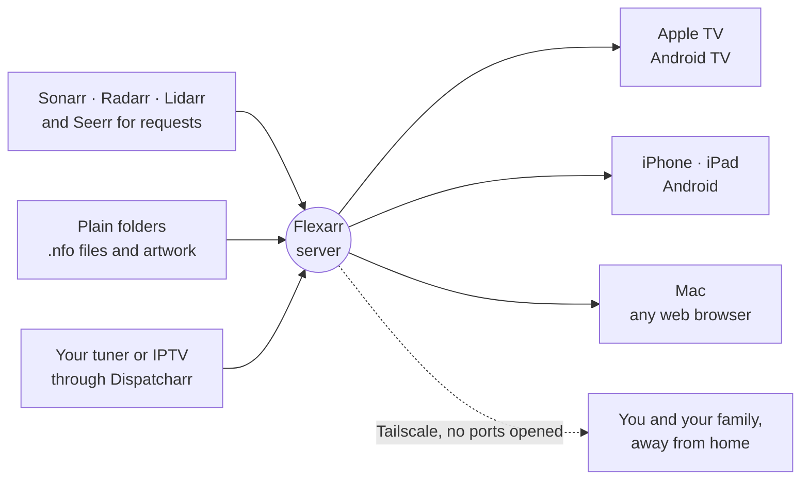
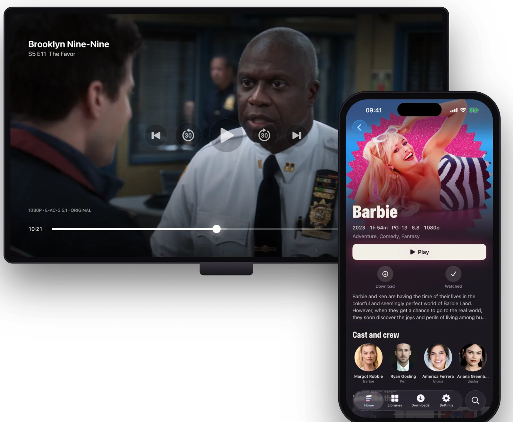
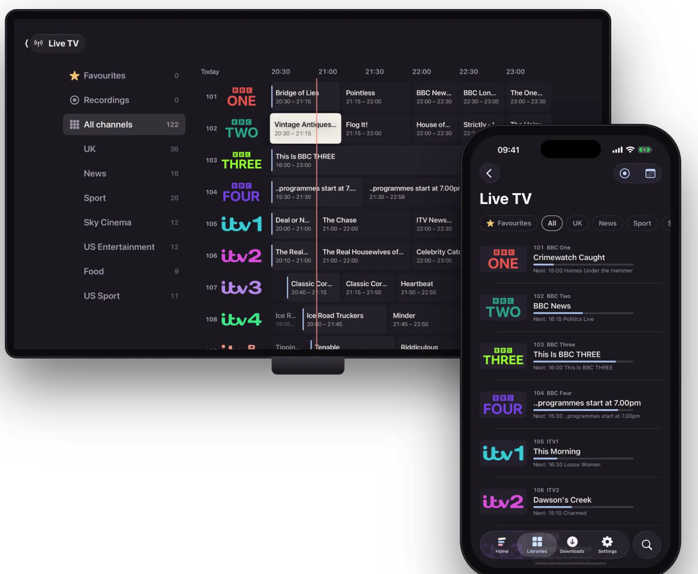
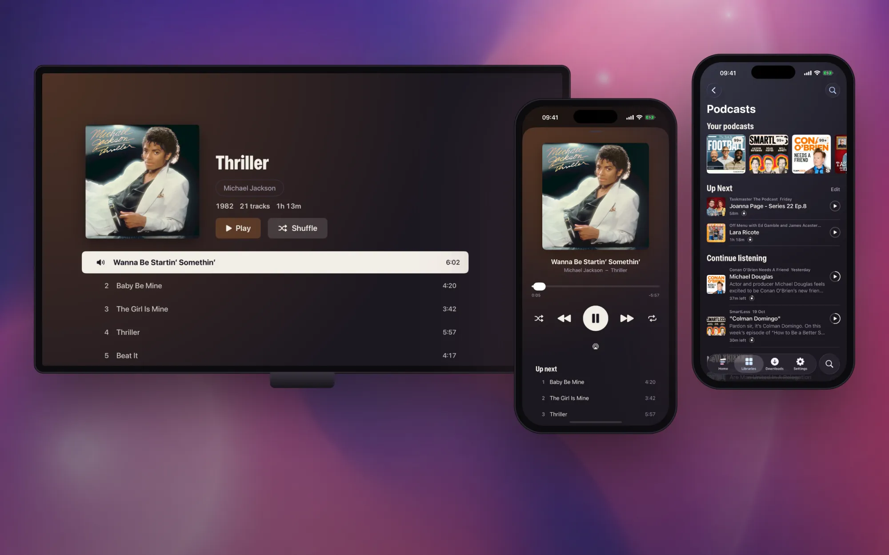
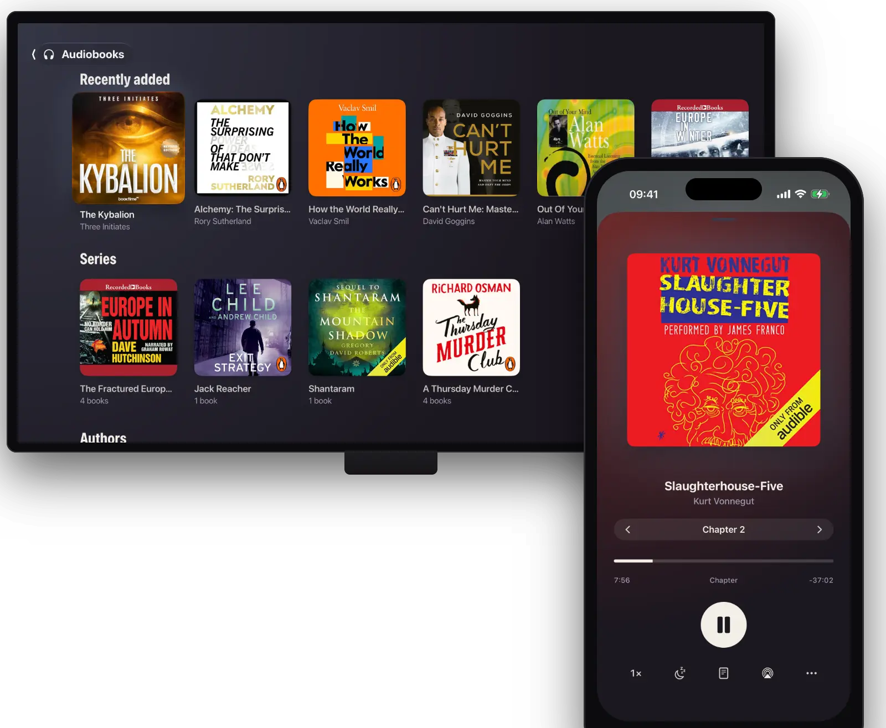
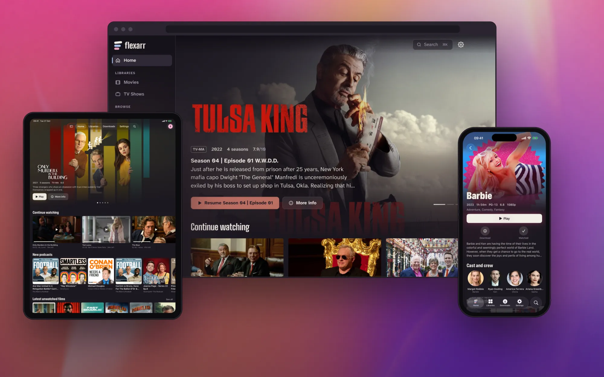
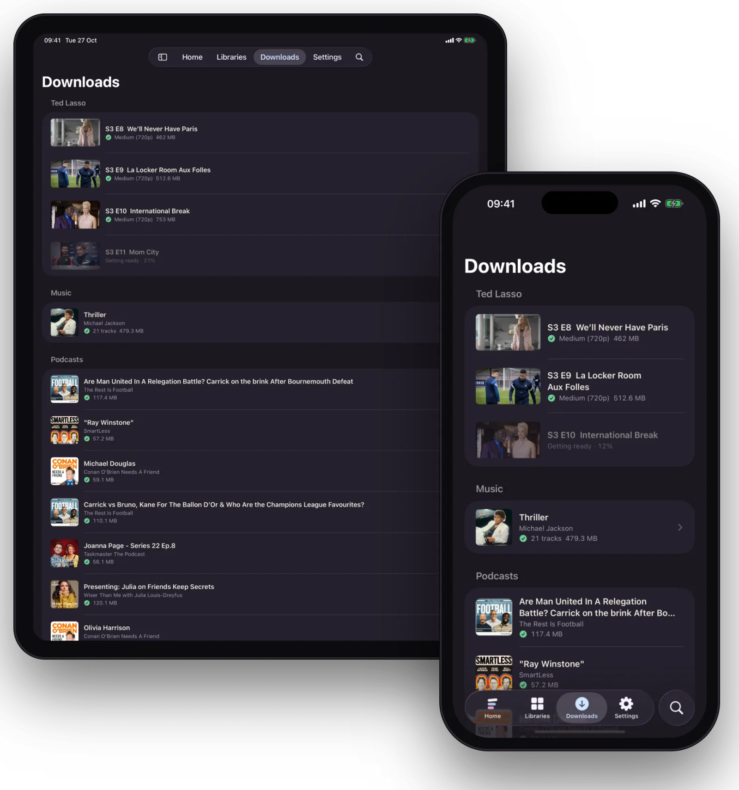

<p align="center">
  
</p>

<h1 align="center">Flexarr</h1>

<p align="center"><strong>Your entertainment. Every screen.</strong></p>

<p align="center">
  Your own streaming service for the films, TV, music, podcasts and audiobooks you already have.<br>
  No ads, no account, no subscription, no cloud in the middle.
</p>

<p align="center">
  <a href="https://github.com/danleach-glitch/flexarr/releases"></a>
  <a href="https://github.com/danleach-glitch/flexarr/actions/workflows/ci.yml"></a>
  <a href="https://github.com/danleach-glitch/flexarr/pkgs/container/flexarr"></a>
  <a href="https://apps.apple.com/app/flexarr/id6826618084"></a>
  <a href="https://apps.apple.com/app/flexarr-server/id6827844952"></a>
  <a href="LICENSE"></a>
</p>

<p align="center">
  <a href="https://flexarr.io">flexarr.io</a> ·
  <a href="#-get-started">Get started</a> ·
  <a href="#-every-screen">Apps</a> ·
  <a href="https://flexarr.io/guide">Guide</a> ·
  <a href="CHANGELOG.md">Changelog</a> ·
  <a href="docs/roadmap.md">Roadmap</a>
</p>

<p align="center">
  
</p>

Flexarr is a media server you run at home, with its own apps for Apple TV, iPhone, iPad, Mac and Android, and a web player built in. It takes artwork and details from the Sonarr, Radarr and Lidarr you already run (or from the `.nfo` files and artwork beside your files), and plays to every screen: as the file is when the device can manage it, converted on the fly when it can't. It runs a real 12,000-file library every day.



## 🎬 Watch

<p align="center">
  
</p>

- **Plays files as they are.** AV1, HEVC, VC-1, XviD and the rest go straight to the device when it can play them, and the server converts only what it must, using your graphics hardware.
- **Picture and sound untouched.** HDR10, HDR10+, HLG and Dolby Vision reach the TV as made, Dolby Atmos passes through intact, and films ask the TV for their own frame rate, so 24-frame films play without judder.
- **Starts almost at once**, even for a 4K film, with scrubbing previews as you move through it.
- **Its own player** on every app: **Skip intro** and **Skip credits** with a countdown, **Up Next**, Picture in Picture and AirPlay.
- **4K and 1080p copies as one title.** Keep both and Flexarr shows one page, picks the best copy each device can play without converting, and remembers if you choose another.
- **Subtitles your way.** Styled ones shown as made, placed and sized as you like, synced per file, and found through Bazarr when a file has none.
- **Dialogue boost and night mode**, on by themselves at night if you like, and stereo or 5.1 to suit your speakers.
- **IMDb and Rotten Tomatoes scores**, cast, trailers and what's similar on every film and show.
- **Fix match** when a title is wrong, or edit its details by hand.

## 📺 Live TV

<p align="center">
  
</p>

- **A full guide** from your own tuner or IPTV service through [Dispatcharr](https://github.com/Dispatcharr/Dispatcharr), with channel groups and favourites.
- **Pause and rewind live TV**, and **record** a programme or a whole series, with recordings in their own library.

## 🎵 Listen

<p align="center">
  
</p>

- **Music** from Lidarr or your folders, with synced lyrics, playlists, daily mixes, artist radio, gapless playback and crossfade, and a visualiser on the Apple TV.
- **Ask for new music** and Lidarr fetches it; follow artists to hear when they release something.
- **Podcasts built in.** Search Apple's directory or add any feed, with chapters, Up Next across devices and OPML import. Nothing extra to run.
- **Audiobooks** from your folders: chapters, series, narrators, speed per book, bookmarks and a sleep timer.
- **CarPlay and Android Auto** for music, podcasts and books in the car.

<p align="center">
  
</p>

## 👪 For the whole household

- **Profiles** with their own history, libraries, watchlist and PIN, and **Who's watching?** on the TV.
- **Kids profiles** with UK or US age ratings (any country's ratings counted), and a **child lock** that keeps them there.
- **Invite family** to watch from their own homes: a code connects their apps, with no account or setup for them.
- **Requests** through Seerr: find a film or show, ask for it, and see when it's arrived.
- **A watchlist** of things to watch later, whether you have them yet or not, kept in step with **Trakt** along with your history.
- **Plex history import**, so everyone carries on where they left off.

## 📱 Made for each device

<p align="center">
  
</p>

- **Native apps**, not a web page in a wrapper: SwiftUI on Apple TV, iPhone, iPad and Mac, and Kotlin on Android and Android TV.
- **Downloads** of films, a whole show or season, albums, playlists, podcasts and books for the plane, with the watch state sent back when you're online again.
- **Your iPhone as the Apple TV's remote**, on the Lock Screen too, and **Continue on iPhone** to carry on from the sofa.
- **Siri and Shortcuts**: "Play the next episode of *Ted Lasso* in Flexarr", "Skip forward 30 seconds in Flexarr". "Hey Google" on Android.
- **Widgets, notifications, the Apple TV Top Shelf** and Android TV's **Watch Next** row.
- **Away from home over Tailscale**, built into the apps: no ports opened, and they switch between home and away by themselves.

<p align="center">
  
</p>

## 🧰 Looks after itself

- **A setup guide** that finds the \*arrs on your network, adds their webhooks and turns their folders into libraries.
- **Built on your \*arrs.** Details and artwork come from Sonarr, Radarr and Lidarr, so there are no TMDB keys to get and nothing is looked up twice.
- **Or without them.** `.nfo` files and artwork from Kodi, Jellyfin or Plex folders, TVmaze for shows, and TMDB with a free key. What's on disk always wins, and Flexarr never writes to it.
- **Notices new files** in your folders as they arrive.
- **Home videos** arranged by folder and never looked up online.
- **Library health**, backups, readable logs, and one-click updates on a Mac.
- **[Home Assistant](https://github.com/danleach-glitch/flexarr-home-assistant)** so the lights dim when a film starts, and an **MCP server** for Claude or any assistant.

## 📲 Every screen

<!-- apps:start (made by `make apps` from site/apps.json; edit that, not this) -->
| App | Status | Version | Get it |
| --- | --- | --- | --- |
| **Server + Web Player**<br><sub>Docker · Synology · Unraid · Linux · Windows · Mac</sub> | ✅ Available | 0.65.0 | [Set up your server](https://flexarr.io/#setup) · [What's new](https://github.com/danleach-glitch/flexarr/releases) |
| **Server for Mac** | ✅ Available | 0.57.0 | [Mac App Store](https://apps.apple.com/app/flexarr-server/id6827844952) · [Guide](https://flexarr.io/guide/install-macos) |
| **iPhone and iPad** | ✅ Available | 0.57.0 | [App Store](https://apps.apple.com/app/flexarr/id6826618084) · [Guide](https://flexarr.io/guide/connect-devices#iphone-and-ipad) |
| **Mac** | ✅ Available | 0.62.1 | [Download for Mac](https://github.com/danleach-glitch/flexarr/releases/latest/download/Flexarr.dmg) · [Guide](https://flexarr.io/guide/connect-devices#mac) |
| **Apple TV** | 🟡 Coming soon | 0.57.0 | <sub>With Apple for review. Can't wait?</sub><br>[Install it from Xcode](https://flexarr.io/guide/apple-tv-xcode) · [Guide](https://flexarr.io/guide/connect-devices#apple-tv) |
| **Android phone and tablet** | 🛠️ In development |  | <sub>Until then, the web player works in your phone's browser.</sub> |
| **Android TV and Google TV** | 🛠️ In development |  | <sub>Built on the Android app, and laid out like the Apple TV app.</sub> |
| **Home Assistant** | ✅ Available | 0.1.1 | [Get it on GitHub](https://github.com/danleach-glitch/flexarr-home-assistant) · [Guide](https://flexarr.io/guide/home-assistant) |
<!-- apps:end -->

Every app connects with a short code you approve on your phone, or in **Settings › Security › Connect a device** on the web; see [Connect your devices](https://flexarr.io/guide/connect-devices). Every app, its status and version are also on [flexarr.io/apps](https://flexarr.io/apps).

## 🚀 Get started

| You have | Do this |
| --- | --- |
| **A Mac** | Get [Flexarr Server](https://apps.apple.com/app/flexarr-server/id6827844952) from the Mac App Store, choose your media folders, and it runs from the menu bar. |
| **Docker** (Linux, Windows, a NAS) | Run the command below, or follow the guide for [Synology](https://flexarr.io/guide/install-synology) or [Unraid](https://flexarr.io/guide/install-unraid). |
| **A Mac, without the App Store** | [Install natively](https://flexarr.io/guide/install-macos), with one-click updates. |

```bash
docker run -d --name flexarr --restart unless-stopped \
  -p 8383:8383 \
  -v flexarr-config:/config \
  -v /path/to/media:/data/media \
  ghcr.io/danleach-glitch/flexarr:latest
```

Open the link in the server's log (`docker logs flexarr`): it has the setup code filled in, so you only choose a PIN. A short guide then connects Sonarr, Radarr and Lidarr, adds your libraries, everyone who watches, and your devices. Skip any of it and find it later in **Settings**.

**Guides** on [flexarr.io/guide](https://flexarr.io/guide):

- **Install:** [Docker](https://flexarr.io/guide/install-docker) · [Synology](https://flexarr.io/guide/install-synology) · [Unraid](https://flexarr.io/guide/install-unraid) · [macOS](https://flexarr.io/guide/install-macos)
- **Set up:** [First setup](https://flexarr.io/guide/first-setup) · [Connect your \*arrs](https://flexarr.io/guide/connect-arrs) · [Without Sonarr and Radarr](https://flexarr.io/guide/without-arrs) · [Media paths](https://flexarr.io/guide/media-paths) · [Away from home](https://flexarr.io/guide/away-from-home)
- **Help:** [Updating](https://flexarr.io/guide/updating) · [Troubleshooting](https://flexarr.io/guide/troubleshooting) · [FAQ](https://flexarr.io/guide/faq)

The guide's source is in [docs/guide](docs/guide); corrections are welcome.

## 🛠️ Contributing

The server is .NET 10 with FFmpeg, the web app React and TypeScript, the Apple apps SwiftUI and the Android app Kotlin and Compose, all in this one repository. [CONTRIBUTING.md](CONTRIBUTING.md) has the setup, the `make` commands and what lives where; [docs/architecture.md](docs/architecture.md) explains how it fits together, and the [roadmap](docs/roadmap.md) what's next.

## 📄 Licence

Free to use, change and share for any noncommercial purpose under the [PolyForm Noncommercial License 1.0.0](LICENSE): personal use, home servers, and charities, schools and other noncommercial organisations. Selling Flexarr, or using it in a commercial product or service, needs a separate licence from the author. Because of that restriction, Flexarr is *source-available* rather than open source in the [OSI's sense](https://opensource.org/osd).

## 🙏 Acknowledgements

Flexarr is built on many other projects: the \*arr apps it works with, FFmpeg, AetherEngine and more, all credited with their licences in [ACKNOWLEDGEMENTS.md](ACKNOWLEDGEMENTS.md).

Flexarr uses Trakt but is not endorsed or certified by Trakt. This product uses the TMDB API but is not endorsed or certified by TMDB.
