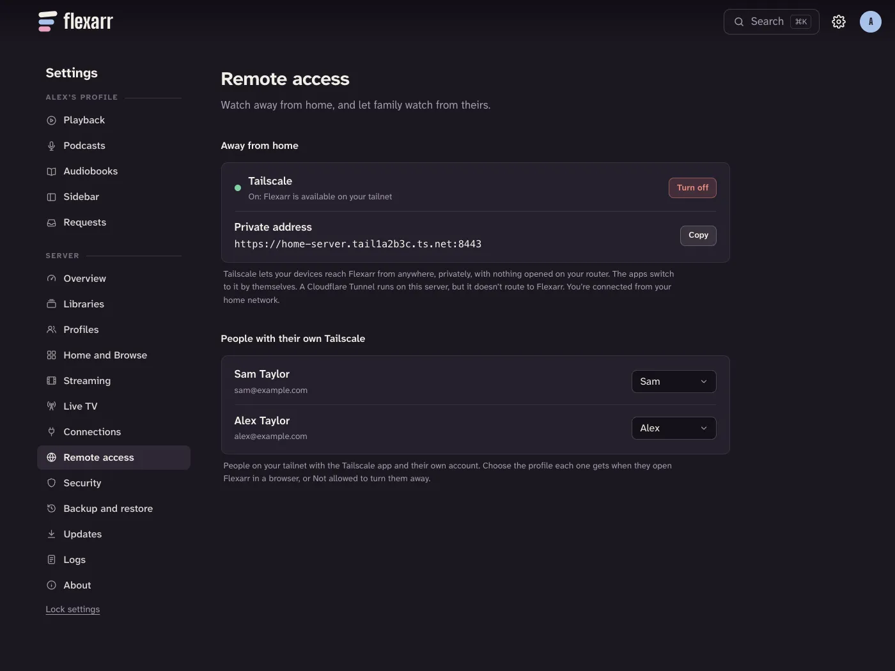

At home, your devices find Flexarr on the Wi-Fi. Away from home, they need a safe way back to it. The easiest is **Tailscale**, and it's the one Flexarr is built around. If you already run an HTTPS reverse proxy, that works too.

## Tailscale

[Tailscale](https://tailscale.com) is a free app that puts your devices on a small private network of their own, called a tailnet. Your phone can then reach your server from a hotel or a train as if it were at home. The connection is encrypted, and nothing is opened on your router, so Flexarr isn't on the public internet.

### Set it up

1. **On the server**, install Tailscale from [tailscale.com/download](https://tailscale.com/download) and sign in.
2. In Flexarr on the web, signed in as the main profile, go to **Settings › Remote access**. Under **Away from home**, Tailscale should say it's connected. Choose **Turn on**.
3. Flexarr shows its **Private address**, something like `https://your-server.your-tailnet.ts.net:8443`. It's HTTPS, with a real certificate from Tailscale.
4. **On your iPhone or iPad**, install Tailscale from the App Store and sign in with the same account. Leave it connected.
5. Open the Flexarr app once while you're at home, so it learns the private address.



From then on, the iPhone, iPad and Apple TV apps switch by themselves. When the home address doesn't answer, they use the Tailscale one, and they go back to the home address when you're home again. There's nothing to change in the apps.

In a browser away from home, open the private address instead of the usual one.

> **Note**
> Flexarr needs the `tailscale` command on the same computer it runs on to turn this on. In Docker it can't see the Tailscale installed around it, so **Settings › Remote access** says **Not available in Docker**. To use Flexarr away from home from Docker, put it behind an [HTTPS reverse proxy](#an-https-reverse-proxy-instead), or run Flexarr without Docker on a computer with Tailscale.

### Who can get in

When you first turn it on, your own Tailscale account is linked to the main profile. Anyone else you invite to your tailnet appears under **People with their own Tailscale** in **Settings › Remote access**. Choose a profile for each person. Anyone set to **Not allowed** is turned away, even though Tailscale lets them reach the server.

Over Tailscale, watching works as it does at home. Changing settings is stricter: you'll be asked to choose the main profile with the admin PIN. That browser then stays signed in until it's signed out, or left unused for two weeks. See [Unlocking settings](profiles.md#unlocking-settings) for the admin PIN.

> **Important**
> Someone on your tailnet whose account is linked to another profile can only choose the main profile with the admin PIN, even if it has a PIN of its own. Changing settings over Tailscale asks for the admin PIN, as it does at home.

Don't use **Tailscale Funnel** for Flexarr. Funnel publishes an address to the whole internet. If Flexarr spots it, Settings warns you; turn remote access off and on again to make it private.

## Quality away from home

Hotel Wi-Fi and phone data are slower than your home network, and so is the upload speed of most home broadband.

- **Live TV** comes in a reduced version away from home: at most 720p, at about 2.5 Mbps, in stereo. At home, channels play as they come.
- **Films and shows** play as they do at home unless you set a limit. In **Settings › Streaming**, **Limit each stream to** caps every stream; **4 Mbps** is a good choice for watching away. The limit applies at home too.
- **On the web**, the player's quality menu lets you choose 1080p, 720p or 480p for one viewing.
- **On iPhone and iPad**, downloading before you leave avoids the question altogether. See [Downloads](downloads.md).

## An HTTPS reverse proxy instead

If you already run a reverse proxy such as nginx, Caddy or Traefik with an HTTPS certificate, you can put Flexarr behind it.

If the proxy runs on another computer, or in Docker, tell Flexarr to believe the visitor addresses it passes on. Add it to `trustedProxies` in `config.json`, in the server's data folder, as a list of addresses or ranges:

```json
{
  "trustedProxies": ["172.17.0.1", "10.0.0.0/24"]
}
```

Without it, everyone who comes through that proxy counts as the internet and has to sign in. Restart Flexarr after editing; it's read at startup.

If the proxy runs on the **same computer** as Flexarr, it must send `X-Forwarded-For`. In nginx:

```nginx
proxy_set_header X-Forwarded-For $remote_addr;
```

To be safe, also set this in `config.json`:

```json
{
  "loopbackNeedsForwarding": true
}
```

Then a request from the same computer that doesn't say who it's for counts as the internet, so a badly set up proxy can't let anyone in. A browser on the server itself then needs the API key too.

> **Important**
> In **Settings › Security**, **Ask for it** set to **Only away from home** lets devices on your home network in as the main profile without a key. With a reverse proxy, that makes the settings above matter. If in doubt, leave it on **Always**.

## Why not forward a port?

It's tempting to open port 8383 on your router and connect to `http://your-home-address:8383`. Please don't. Plain `http://` isn't encrypted, so your API key, your sign-ins and what you watch cross the internet readable by anyone along the way. It also puts your server in front of every scanner on the internet.

Plain `http://` is fine on a home network you trust. Anywhere else, use Tailscale or HTTPS.

## Connecting a device from outside

Devices normally connect with a code you approve in **Settings › Security › Connect a device**, and that only works from your home network or over Tailscale. To connect an app through a reverse proxy instead, use the API key:

- **iPhone and iPad:** on the connect screen, choose **Enter an address instead**, then **Connecting from outside your home? Use an API key**.
- **Apple TV:** the same: **Enter an address instead**, then **Connecting from outside your home? Use an API key**.

The API key is in **Settings › Security** under **API key**. Showing it asks for the admin PIN. It's also in `config.json`.

> **Important**
> The API key gives full control of your server. Don't paste it anywhere you wouldn't paste a password. If it leaks, **Make a new key** in **Settings › Security** replaces it, and can sign out every other browser and device at the same time.
