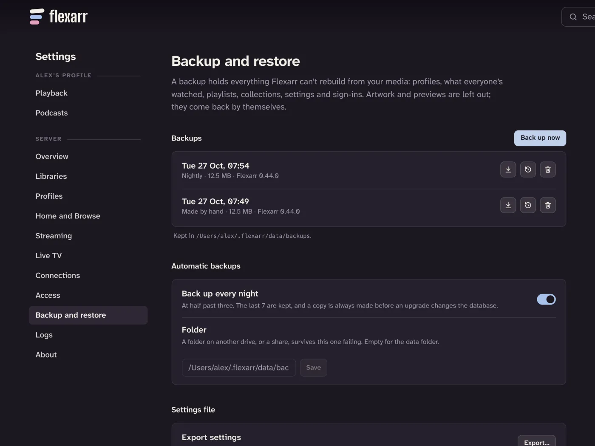

Your films, shows and music live on your own drives, and Flexarr can always scan them again. What it can't rebuild is everything you've added on top: profiles, what everyone has watched, watchlists, playlists, collections, settings and signed-in devices. That's what a backup holds.

Everything here is in the web app under **Settings › Backup & restore**, as the main profile with settings unlocked.

## What's in a backup

- Profiles, with their PINs and pictures, and the admin PIN
- What every profile has watched, and where they stopped
- Watchlists, playlists, collections, podcast follows and other per-profile data
- Each profile's Trakt connection
- The server's settings and keys (`config.json`)
- Signed-in browsers, phones and TVs

Artwork, subtitles and scrubbing previews are left out. They come back by themselves. Your media files and logs aren't included either.

## Automatic backups

Flexarr makes a backup every night at half past three and keeps the last 7. If the server was off overnight, it catches up a few minutes after it next starts.

It also makes one before an upgrade changes the database, and before a restore, so you can always go back. The last 3 of each of those are kept. Backups you make by hand are never deleted automatically.

To stop the nightly backups, turn off **Back up every night** under **Automatic backups**. We don't recommend it.

## Back up now

Choose **Back up now** at any time, for example before changing a lot of settings. Each backup in the list shows when it was made, why (**Nightly**, **Made by hand**, **Before an upgrade**, **Before a restore**), its size and the Flexarr version.

## Where backups are kept

The list says where: **Kept in** and the folder. By default that's a `backups` folder inside Flexarr's data folder:

| Install | Default backups folder |
| --- | --- |
| Mac | `~/.flexarr/data/backups` |
| Docker | `/config/backups` inside the container, so wherever you mapped `/config` |

A backup on the same drive as Flexarr won't help if that drive fails. To keep them elsewhere, type another folder under **Automatic backups › Folder** and choose **Save**: a second drive, or a network share mounted on the server. In Docker, the folder has to be one you've mapped into the container. Leave it empty to go back to the data folder.

If the chosen folder isn't there when a backup is due (a drive that's unplugged, or a share that didn't mount), Flexarr says so on the page rather than quietly filling up its own drive.

## Download a backup

Use the **Download** icon on a backup to save a copy to your computer. You can protect it with a passphrase of at least 8 characters. The file holds your server's keys and the passwords for Sonarr, Radarr and the like, so either set a passphrase or keep the file somewhere private.

> **Tip** Flexarr asks for the passphrase when you open the file later. Keep it in a password manager.

## Restore a backup

Restoring puts the whole server back to how it was when the backup was made: profiles, what's been watched, and all your settings, keys and sign-ins. Anything since is lost.

1. Find the backup in the list and use its **Restore** icon. To restore a file you downloaded, use **From a file** further down the page instead (below).
2. Read the warning, and enter the admin PIN.
3. Choose **Restore and restart**.

Flexarr first makes a copy of the server as it is now (it appears in the list as **Before a restore**), so you can change your mind. It then restarts to put the backup in place. Anyone watching is stopped. The page reloads when Flexarr is back.

Before anything changes, the backup is checked. A damaged one, one made by a newer version of Flexarr, or a file that isn't a Flexarr backup is refused. This machine's own paths (ffmpeg and the cache) are kept as they are.

> **Important** Flexarr stops itself to finish a restore and relies on whatever runs it to start it again. The Mac install does this. In Docker, the container needs a restart policy such as `--restart unless-stopped` (or `restart: unless-stopped` in Compose). Without one, start the container again by hand within the hour, or the restore is dropped.

## Restore or import from a file

**From a file** takes either a downloaded backup or a settings file (below), from this server or another.

1. Choose **Choose a file…** and pick the file.
2. If it's protected, enter its passphrase and choose **Open**.
3. Flexarr shows what's inside: when it was made, by which version, and how many profiles, libraries and titles it holds.
4. For a backup, choose **Restore…** and carry on as above.

If the backup came from a different Flexarr server, Flexarr points this out. Restoring it brings that server's keys and its signed-in browsers and devices, so only restore one you made yourself.

## Moving to another server

Two ways, depending on what you want to take:

- **Everything, history included:** download a backup on the old server and restore it on the new one with **From a file**. Mount your media at the same paths on the new machine, or fix up the library folders afterwards in **Settings › Libraries**.
- **Settings only:** use **Export…** under **Settings file** on the old server, then **From a file** on the new one. A settings file holds libraries and the server's settings, without profiles, watch history or Trakt connections.

When you import a settings file, you choose which parts to take: **Libraries**, **Connections** (Sonarr, Radarr, Lidarr, Seerr, Bazarr, the TMDB key, your own Trakt app and path mappings), **Live TV**, **Streaming**, **Home & browse** (for profiles that haven't chosen their own rows), **Podcasts**, **Notifications**, **Access**, **This machine's paths** and **Server keys**. Each library's folders can be changed to where they are on the new machine. **This machine's paths** and **Server keys** start unticked, and taking either of them, or **Access**, asks for the admin PIN. Log and update settings, and the admin PIN, aren't in a settings file: the new server keeps its own.

See also [Updating](updating.md), which makes its own backup before any upgrade that changes the database.
