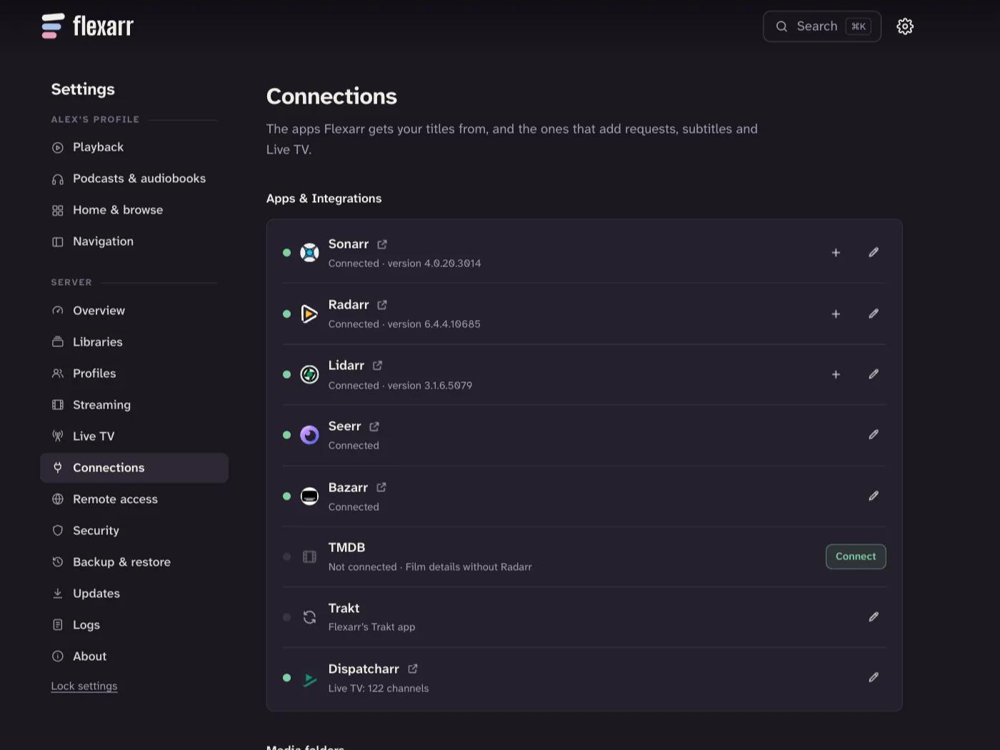

Flexarr is built to sit alongside Sonarr, Radarr, Lidarr and Seerr. It doesn't download anything itself; it takes its artwork and details from them, and they tell it when something new arrives. If you don't run them yet, Flexarr still plays your files. See [What you need](what-you-need.md) for what you get with and without each one.

## What each connection gives you

| App | What Flexarr gets from it |
| --- | --- |
| **Radarr** | Titles, posters, backgrounds, overviews, genres, ratings and trailers for films. Upcoming films in **Coming soon**. Deleting a film from Flexarr goes through Radarr. Film series for collections. |
| **Sonarr** | Show and episode details and artwork. Upcoming episodes in **Coming soon**. Deleting a show or episode goes through Sonarr. |
| **Lidarr** | Artist pictures, album covers, canonical names and years, and albums, EPs and singles sorted apart. |
| **Seerr** | **Discover** and requests. Seerr and Overseerr both work. See [Requests](requests.md). |
| **Bazarr** | **Search for subtitles** from the player and a title's page, and re-syncing subtitles that are out of time. See [Finding subtitles](subtitles-and-skipping.md#finding-subtitles). |

Films and shows that Radarr or Sonarr don't manage are still looked up through their search, so a connected Radarr fills in artwork even for films it didn't download.

## Add a connection

You need two things for each app: its **address** and its **API key**.



1. In Flexarr, go to **Settings › Connections**.
2. Every app Flexarr works with is listed under **Apps & Integrations**. Find the one you want and choose **Connect**.
3. Type its **Address**, such as `http://192.168.1.20:7878`.
4. Paste its **API key**.
5. Choose **Test**. A tick means Flexarr reached it; otherwise you'll see what went wrong.
6. Choose **Connect**.

Repeat for each app. Each one then shows a green dot, its version, and a link to open it. Choose the pencil to change or remove it.

If you run more than one Sonarr, Radarr or Lidarr, such as a second Radarr for 4K films, choose **+** beside the one already connected and give the new one a **Name** of its own, such as "Radarr 4K".

### The address

Use the address Flexarr can reach the app on, with its port. The usual ports are:

| App | Usual address |
| --- | --- |
| Sonarr | `http://<host>:8989` |
| Radarr | `http://<host>:7878` |
| Lidarr | `http://<host>:8686` |
| Seerr | `http://<host>:5055` |
| Bazarr | `http://<host>:6767` |

`localhost` only works if the app runs on the same machine as Flexarr *and* neither is in its own Docker container. Between containers, use the machine's IP address, or the container's name if they share a Docker network.

### Where to find each API key

| App | Where its API key is |
| --- | --- |
| Sonarr | **Settings › General**, under **Security** |
| Radarr | **Settings › General**, under **Security** |
| Lidarr | **Settings › General**, under **Security** |
| Seerr | **Settings › General** |
| Bazarr | **Settings › General**, under **Security** |

### Seerr

Seerr has its own row under **Apps**. Choose the pencil beside **Seerr**, type its **Address** and **API key**, and choose **Save**. Once it's connected, **Discover** fills with what's trending and popular, and you can request what you don't have. See [Requests](requests.md).

### Bazarr

Bazarr has its own row too. Choose the pencil beside **Bazarr**, type its **Address** and **API key**, and choose **Save**. Bazarr needs Sonarr and Radarr connected on its side, at least one languages profile and some subtitle sites (providers); set those up in Bazarr itself. A title you search for gets Bazarr's first languages profile if it has none, so Bazarr's own schedule may then fetch subtitles for it too. See [Finding subtitles](subtitles-and-skipping.md#finding-subtitles).

## Webhooks: new downloads appear straight away

Without webhooks, Flexarr finds new files on its own scan every 12 hours. With them, Sonarr, Radarr and Lidarr tell Flexarr the moment they import, upgrade, rename or delete something, and Flexarr rescans only that folder.

The addresses to use are at the bottom of **Settings › Connections**, under **Webhooks**, already filled in with your server's address and its **webhook secret**. They look like this:

```text
http://<flexarr-host>:8383/api/v1/webhooks/sonarr?secret=<webhook-secret>
http://<flexarr-host>:8383/api/v1/webhooks/radarr?secret=<webhook-secret>
http://<flexarr-host>:8383/api/v1/webhooks/lidarr?secret=<webhook-secret>
```

The secret can only start scans, so you don't hand your API key to the *arr apps.

In each app:

1. Go to **Settings › Connect**, choose **+**, then **Webhook**.
2. Give it a name, such as "Flexarr".
3. Under triggers, turn on the ones for **importing**, **upgrading**, **renaming** and **deleting** files. Their names vary a little between apps and versions, such as **On File Import**, **On File Upgrade**, **On Rename**, and the **Delete** triggers. Adding a series, film or artist works too. Other triggers, such as **On Grab** or health events, are accepted and ignored.
4. Paste the address for that app into **Webhook URL**.
5. Leave **Method** as **POST**.
6. Choose **Test**, then **Save**.

> **Important** The webhook addresses are built from the address you opened Flexarr on. If you're using it at `localhost`, the address won't work from another machine or container. Swap in the server's IP address or name. If the *arrs run in Docker on the same Mac as a native Flexarr, use `host.docker.internal` in place of the host name.

**Make a new secret** replaces the webhook secret if it's ever got out. The *arr apps can't start scans until you give them the new addresses.

## Paths must match

When Sonarr says "I've imported `/tv/Show/Season 1/episode.mkv`", Flexarr has to find that same file. If the *arr apps and Flexarr see your media under different paths, as often happens with Docker, webhooks and some matching won't work. See [Media paths](media-paths.md) to line them up.

## Checking it works

- **Settings › Connections** shows each app's dot: green when Flexarr can reach it.
- **Coming soon** in the sidebar lists upcoming episodes and films from Sonarr and Radarr.
- Download something, and it should appear in Flexarr within a few seconds of the *arr importing it.

If artwork is missing on titles that were already there before you connected Radarr or Sonarr, choose **Refresh artwork and details** on the library in **Settings › Libraries**.
