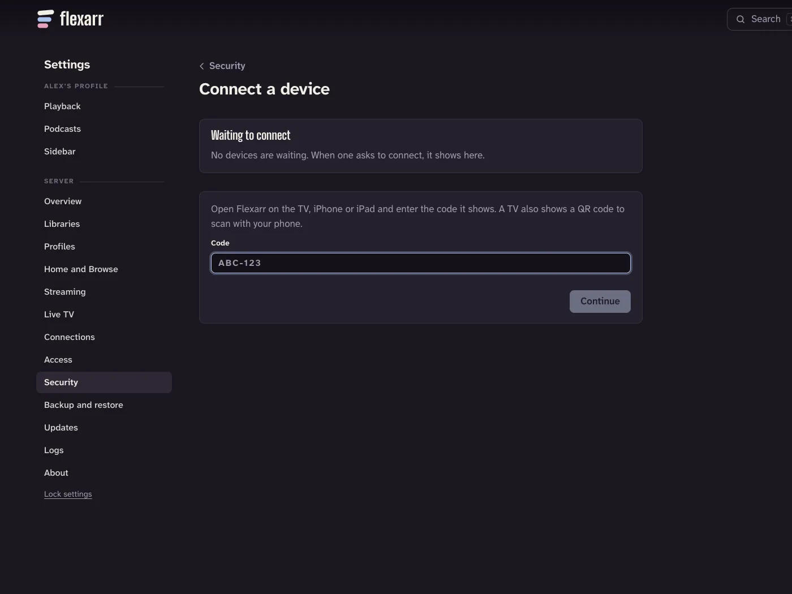

Every device signs in to your server with a code. The device shows the code, and you type it in on the computer where you [set up Flexarr](first-setup.md). Each device then gets a sign-in of its own, which you can rename or sign out at any time.

## iPhone and iPad

Get the app [from the App Store](https://apps.apple.com/app/flexarr/id6826618084).

The first time you open it, three short cards explain what Flexarr is, that it plays from your own Flexarr server at home, and how it finds that server on your Wi-Fi. If you haven't set up a server yet, **Set up at flexarr.io** brings you to this guide. If you have, choose **Skip**, or **Next** through to **Find my server**.

1. When iOS asks whether Flexarr can find devices on your local network, choose **Allow**. Without it, the app can't see your server.
2. Under **Servers on your network**, choose your server.
3. The app shows **Connect this iPhone** (or iPad) with a code like `ABC-123`.
4. On your computer, open the server's address in a browser, go to **Settings › Access › Connect a device**, type in the code and choose **Continue**.
5. Check that the code matches the one on your phone, and choose **Allow**.

The app moves on by itself a moment later. If your household has several profiles, it asks who's watching.

If Safari on the same phone is already signed in to Flexarr, **Approve in Safari instead** opens the approval page there, so you don't need the computer.

## Apple TV

The Apple TV app isn't on the App Store yet. Until it is, [install it with Xcode](apple-tv-xcode.md).

1. Open Flexarr on the Apple TV. It lists **Servers on your network**; choose yours.
2. The TV shows **Connect this Apple TV** and a code.
3. On your computer, go to **Settings › Access › Connect a device**, type in the code, then choose **Continue** and **Allow**.

The TV also shows a QR code. Scan it with a phone that's already signed in to Flexarr in its browser, and the approval page opens with the code filled in.

> **Note** If a code runs out before you've typed it, choose **New code** on the device.

## Other browsers

Browsers don't get a code. Open the server's address in the new browser and it asks for the **API key**: type it in once, and the browser gets a sign-in of its own, so it doesn't keep the key. The key is in **Settings › Access** on the browser you set up with (see [The API key](first-setup.md#the-api-key)).

Over [Tailscale](away-from-home.md), browsers sign in by your Tailscale account instead, with no key.

## Who can approve a device

Only the **main profile** can connect devices. If the browser you're using is on another profile, the **Connect a device** page says so and offers **Switch to the main profile** (asking for its PIN, if it has one).

When the approval page says the request **didn't come from your home network**, be careful: only allow it if your own device is showing that code and you started it a moment ago. If someone sent you a link to approve, choose **Don't allow**.

## If the app can't find your server

The apps find the server by asking the network for it. When **Looking for Flexarr…** doesn't turn into your server, work through these.

### Same Wi-Fi

The device and the server must be on the same network. Phones on mobile data, or on a **guest network**, can't see it. Many routers keep guest Wi-Fi apart from everything else on purpose, and some mesh systems and access points have a setting called **client isolation** or **AP isolation** that does the same on the main network. Connect to your main Wi-Fi, or turn isolation off.

### Local network permission (iPhone and iPad)

If you chose **Don't Allow** when iOS asked, the app can't look for servers. Open the iPhone's **Settings › Privacy & Security › Local Network** and turn **Flexarr** on.

### Firewall

The server's firewall must let other devices reach port **8383**. On a Mac with the firewall turned on (**System Settings › Network › Firewall**), check it isn't blocking incoming connections. Check you can open `http://<server>:8383` from another computer at home; if a browser can't reach it, the apps can't either.

### Servers that don't announce themselves

Finding the server by itself works when Flexarr runs natively on a Mac. In Docker, including on a Synology or Unraid server, the container usually can't announce itself to the network, so the app won't list it. Enter the address instead (below).

## Enter an address instead

Every app has **Enter an address instead** under the list of servers.

- **iPhone and iPad:** type the server's address, such as `http://192.168.1.20:8383`, and choose **Connect**. You get a code to approve, as above. Away from home, **Connecting from outside your home? Use an API key** asks for the [API key](first-setup.md#the-api-key) instead.
- **Apple TV:** the same as iPhone: type the address and choose **Connect** to get a code, or **Connecting from outside your home? Use an API key** away from home.

Use the server's IP address and port. You'll find the IP address in your router's list of devices, or on the server itself.

## Manage and remove devices

Signed in as the main profile, go to **Settings › Access**. Under **Signed-in browsers and TVs** you'll see every browser, iPhone, iPad and Apple TV with a sign-in of its own, and when it was last used.

- **Rename** gives a device a name you'll recognise.
- **Sign out** signs out one device. It'll need a new code to come back.
- **Sign out every other browser and TV** signs out everything but the browser you're using.

If you think your API key has got out, **Make a new key** under **API key** replaces it, and can sign every other device out at the same time.

> **Tip** Each phone gets notifications for one profile, the one it was on when you turned them on. See [Notifications and widgets](notifications-and-widgets.md).
