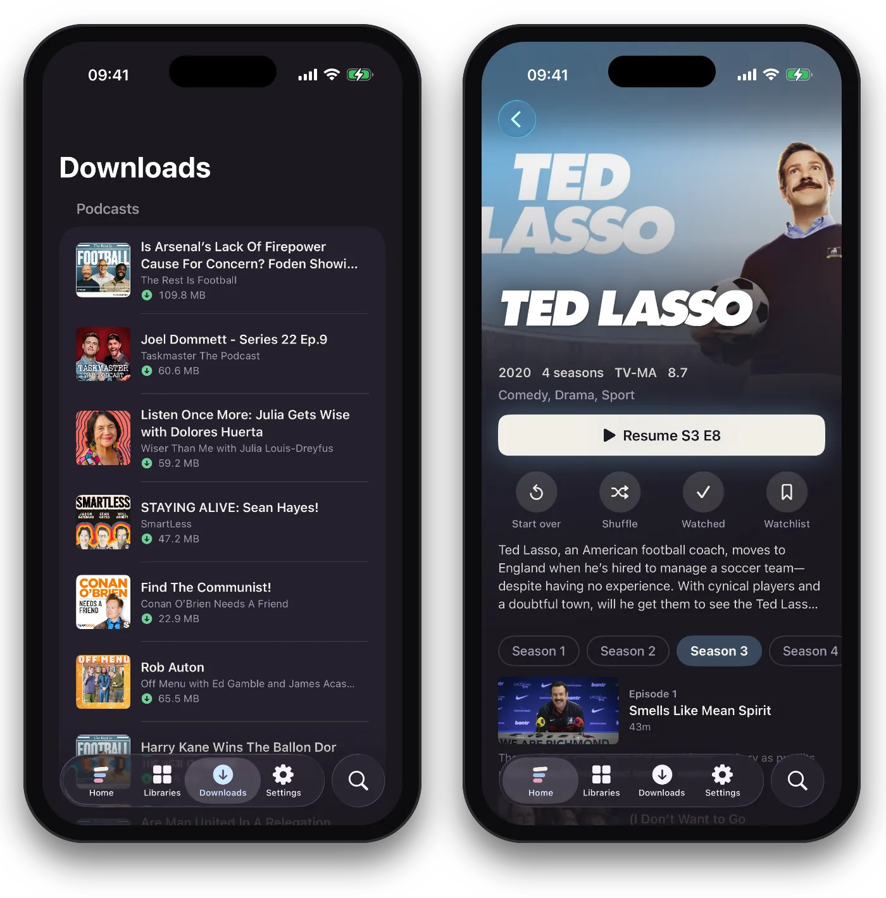

The iPhone and iPad app can keep films, episodes, albums, playlists and podcast episodes on the device, for a flight, a train or anywhere without a signal. In the next release, [audiobooks](audiobooks.md) too.

## Downloading something

Tap the download button on a film's or episode's page, on an album or playlist, or on a podcast episode. It starts straight away, at the size you chose (see [Picture size](#picture-size)).

The button shows how it's going:

- **An hourglass, "Getting ready":** your server is preparing it.
- **Wi-Fi:** it's waiting for Wi-Fi.
- **A filling ring:** it's coming down to the device. Podcast episodes show the ring from the start.
- **A green arrow:** it's ready to play with no connection. (A tick means watched or played.)
- **An exclamation mark:** it failed. Tap it to see why, and to **Try again**.

Tap the button while a download is under way, or once it's here, to remove it. Downloads carry on with the app closed, and pick up where they left off if the connection drops or the phone locks.

Everything you've downloaded is in the **Downloads** tab, where it plays with Skip Intro and the countdown to the next episode as usual.

## What your server does first

Your server gets each download ready before it's sent, one at a time. It converts a film or episode to a size and format the phone plays, or sends it as it is when it can. It does this quietly in the background and waits while anyone is watching something that's being converted, so a download never slows someone's film down.

A prepared download that isn't collected within a week is deleted from the server.

## Picture size

Choose the size once, in the app's **Settings › Downloads › Size**:

- **Automatic (720p):** the default. Looks good on a phone and doesn't take much space. Sound is stereo.
- **Original:** the full picture and sound, but takes the most space. A title whose original won't play on the phone comes at 1080p instead.
- **Small (480p):** the least space, for a long trip on a small phone.

Text subtitles come with the download. Picture-based subtitles (from Blu-rays and DVDs) don't.

Albums, playlists and podcasts come as their files are when the phone can play them: AAC, ALAC, MP3, FLAC, WAV and AIFF. Anything else is converted to AAC.

## Automatic downloads

In **Settings › Downloads**:

- **Download the next episode:** on by default. Once you've downloaded an episode, the next one downloads too. Episodes are deleted a day after you finish them.
- **Automatic downloads on Wi-Fi only:** on by default. Downloads the app starts by itself, like the next episode or new podcast episodes, wait for Wi-Fi. Turn this off to let them use mobile data too.

In the next release, two more for audiobooks, both off to start with:

- **Download the next book in a series:** when you finish a book, the next one in its series downloads.
- **Remove books once finished:** a book is deleted once you've heard it.

Automatic downloads never use Low Data Mode. Downloads you start yourself use mobile data as well as Wi-Fi.

For podcasts, **Auto-download new episodes** in **Settings › Podcasts** keeps the newest unplayed episodes of every show you follow on the device. See [Podcasts](podcasts.md).

## Storage

**Settings › Downloads** shows the space your downloads use, under **Storage**, and has **Delete all downloads**.

To remove one thing, tap its download button and remove it. A podcast episode you delete is never downloaded again by itself.

A podcast episode is deleted as soon as you've heard it to the end or marked it played, here or on another device.

Signing out of the server on the device deletes its downloads.

## Watch progress

What you watch and hear offline is sent to your server when the device is back online. Resume points, watched ticks and Continue Watching then catch up on every other screen.

## Two devices on one profile

An iPhone and an iPad on the same profile each get their own copy of a download. New podcast episodes download by themselves on both.

## Downloading away from home

Downloads work [away from home](away-from-home.md) over Tailscale as well as at home. A big Original download over a slow home upload can take a while, so it's best started at home on Wi-Fi.
