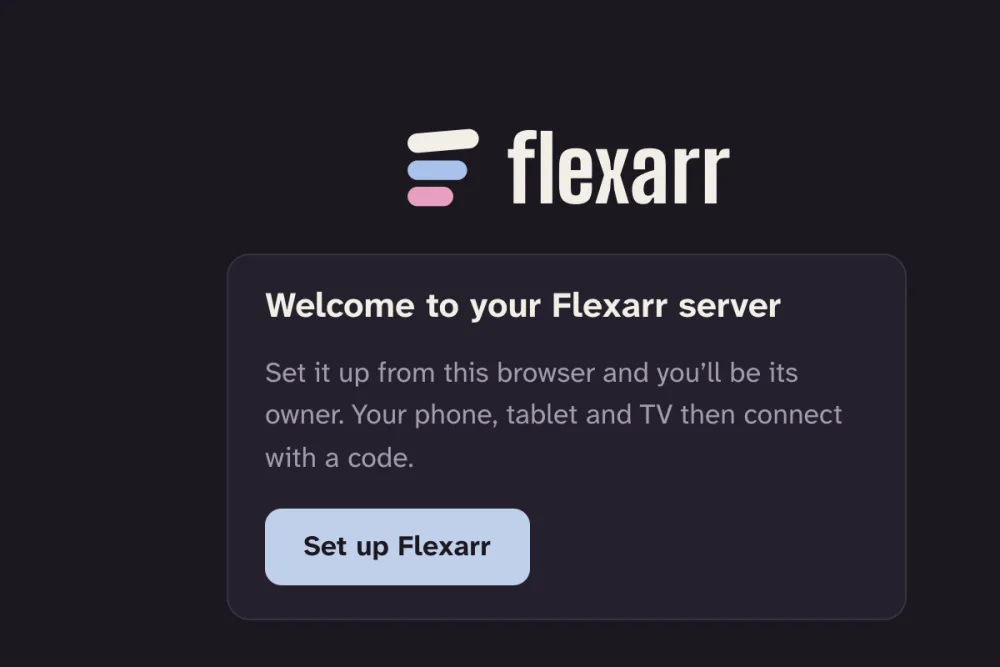
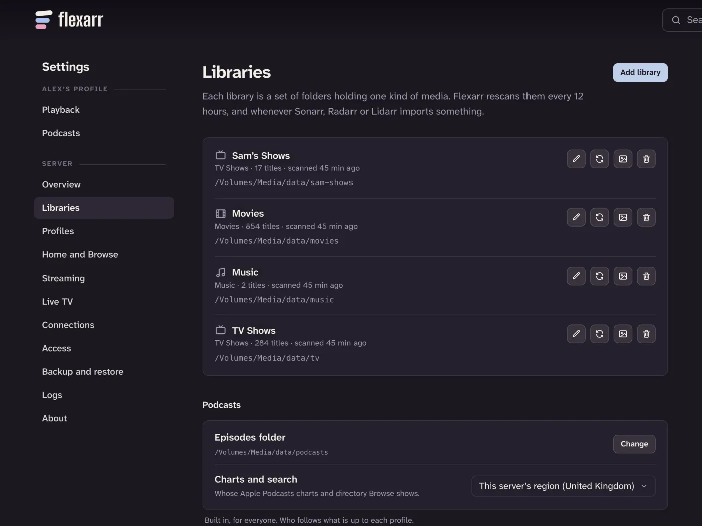

Once the server is installed and running, everything else happens in a web browser. There's no account to make and no key to copy: the first browser on your home network to enter the server's setup code becomes its owner.

## Open Flexarr in a browser

Flexarr listens on port **8383**. On a computer on the same home network as the server, open:

```text
http://<server>:8383
```

Replace `<server>` with the server's address. Any of these usually work:

- On the server itself: `http://localhost:8383`
- The server's name on your network, such as `http://mac-mini.local:8383`
- Its IP address, such as `http://192.168.1.20:8383`. Your router's app or admin page lists the addresses of devices on your network.

If the page doesn't load, check that Flexarr is running (your install guide, linked from [What you need](what-you-need.md), shows how) and that you've typed `http://`, not `https://`.

## Enter the setup code

Usually there's nothing to look up:

- **The Mac app** opens the welcome page in your browser the first time it starts, with the code already filled in. **Open Flexarr** in its menu does the same until the server is set up.
- **Docker** (including Synology and Unraid): the container's log says **Set it up at http://localhost:8383/#setup=…**. Open that link. From another computer, put the server's name or IP address in place of `localhost`. Pasting the whole link into the setup code box works too.

Either way you only choose a PIN. If you open the server's address without the link, it asks for the code itself.

A new server greets you with **Welcome to your Flexarr server** and asks for its **setup code**. The code proves you're the one who installed it: some setups (a reverse proxy, Docker Desktop) make visitors from the internet look as though they're on your home network, and only someone with the server can read its code. It's eight letters and numbers, like `K7QM-3PXT`, and it's in:

- **Docker** (including Synology and Unraid): the container's log. Run `docker logs flexarr`, or open the container's log in your NAS's Docker app. It's also in `setup-code.txt` in the container's settings folder.
- **The Mac app**: the menu bar menu, as **Setup Code**. Choose it to copy the code.
- **macOS (installed with the script)**: `~/.flexarr/logs/console.log`, or `~/.flexarr/data/setup-code.txt`.

Type it in, choose a **PIN** to protect the server's settings (4 to 8 digits, typed twice), and choose **Set up Flexarr**. This browser becomes the server's owner and is signed in. That's the whole sign-up. Watching doesn't need the PIN; changing settings does. If you close the page before choosing **Set up Flexarr**, nothing has happened yet, and the same code still works. The code stops working once the server is set up, and after ten wrong tries it's replaced with a new one (the log says so).




A few things to know:

- **It only works once.** As soon as anyone signs in, setup closes for good. Every other phone, tablet, TV and browser then connects with a code that you approve from this browser. See [Connect your devices](connect-devices.md).
- **It only works from home.** The button appears only to a browser on your home network, reaching the server by its IP address, a `.local` name or the server's own name. That stops anyone on the internet, or a web page you happen to visit, from claiming your server.
- **Servers set up before version 0.49.0 aren't affected.** They keep using the API key, as before.

> **Note** If you see a box asking for an **API key** instead of the welcome, someone has already set this server up, or you're not on the home network. Try opening it by its IP address from a computer at home. If you set it up yourself in another browser, approve this one from there with a code, or sign in with the key (see [The API key](#the-api-key) below).

## The setup guide

Next, Flexarr opens a short setup guide. Every step can be skipped, and **I'll do it myself** leaves the guide whenever you like:

1. **Your apps.** Connect Sonarr, Radarr and Lidarr, if you use them. If Flexarr finds one running nearby, its address is filled in already, and you only paste its API key. Flexarr also adds its own webhook to each app, so new downloads show up straight away (see [Webhooks](connect-arrs.md#webhooks-new-downloads-appear-straight-away)). Don't use them? Choose **I don't use these**.
2. **Libraries.** Each app's media folders are listed, ticked and ready: choose **Add these**. Otherwise, choose a kind under **Add a folder** and pick the folder that holds it.
3. **Who's watching.** Add a profile for each person in the house. See [Profiles](profiles.md).
4. **Your TV and phone.** Open the Flexarr app on your device at home. It shows a code; type it in here. See [Connect your devices](connect-devices.md).
5. **Away from home.** Turn on Tailscale, if you have it. See [Watch away from home](away-from-home.md).

At the end, the guide tells you how the first scan is going, and warns you if a library came up empty or Flexarr can't see one of an app's folders.

If you leave part way, Home lists what's left under **Finish setting up**. Choose a step to go back to it, or **Hide** to put the list away. Everything in the guide is in Settings too, as described below.

You're signed in as the server's **main profile**, the one that can change settings.

## Add your libraries

A library is a set of folders holding one kind of media. Go to **Settings › Libraries** and choose **Add library**.



1. Pick the **Kind**: **Films**, **TV shows**, **Music** or **Home videos** (videos of your own, arranged by folder; see [Without Sonarr and Radarr](without-arrs.md#home-videos)).
2. Give it a **Name** if you like. Left blank, it's named after its kind. You can rename it later.
3. Under **Folders**, browse the server's disks and choose **Use this folder** on the folder that holds that media. Add more than one folder if your films are spread across drives.
4. Choose **Add library**.

The setup guide does this for you; this is how to add one later. Add one library for each kind of media you have. Keep films and TV shows in separate folders: Flexarr expects a films folder to hold films and a TV folder to hold shows.

You can have more than one library of a kind, such as **TV** and **Anime**, or **Films** and **Films in 4K**. Home still shows one **Latest unwatched** row for all your films and one for all your shows, and a title that's in two libraries shows once. To give each library its own row, turn off **Combine libraries of the same kind** in **Settings › Home and Browse**.

> **Important** The folder browser shows the disks as the *server* sees them. In Docker, that means the paths inside the container, such as `/data/media/movies`, not the paths on your NAS. If you can't find your media, check the volumes you gave the container in your install guide.

### Podcasts are built in

You don't need to add a podcasts library. There's always one, listed under **Podcasts** at the bottom of **Settings › Libraries**. Its **Episodes folder** is where episodes wait on their way to phones; you can move it with **Change**. See [Podcasts](podcasts.md).

## The first scan

Adding a library starts a scan straight away. You'll see its progress in **Settings › Libraries**, and titles appear on Home and in the sidebar as they're found.

How long it takes depends on the size of your library and how fast the disks are, and artwork keeps arriving for a while after the files are found. You can start watching as soon as something shows up.

After that, Flexarr rescans every 12 hours, and straight away whenever Sonarr, Radarr or Lidarr tell it about a new download. Each library has buttons to scan it now, refresh its artwork and details, rename it or remove it. Removing a library never deletes your files.

> **Tip** Films and TV shows get their artwork and details through Radarr and Sonarr. If you run them, [connect them](connect-arrs.md) next. Without them, films and episodes still play, named from their files, with artwork and details from any `.nfo` files and images (`poster.jpg`, `fanart.jpg`) beside them, from TVmaze for shows, and from TMDB for films if you add a free key. See [Without Sonarr and Radarr](without-arrs.md). Music reads the tags and cover images in your files, and Lidarr adds more.

## The API key

Flexarr still has an API key. You won't need it for everyday use at home, but it's there for:

- signing in a browser or app away from home, when you don't use [Tailscale](away-from-home.md)
- connecting an Apple TV by typing the server's address, when it doesn't find the server by itself
- scripts, [Home Assistant](home-assistant.md) and [assistants](assistant-mcp.md)
- getting back in if you've lost every signed-in browser

Signed in as the main profile, you can see it in **Settings › Access** under **API key**: choose the eye to show it (with the main profile's PIN, if it has one). **Make a new key** replaces it if it's ever got out.

It's also in the server's settings file, `config.json`, as `apiKey`:

| Installed with | Where `config.json` is |
| --- | --- |
| Docker (including Synology and Unraid) | `/config/config.json` inside the container, which is the folder you mounted at `/config` |
| macOS | `~/.flexarr/data/config.json` |

> **Important** Anyone with the API key can manage your server. Don't post it in screenshots or bug reports.

## Next steps

- [Connect your devices](connect-devices.md): your iPhone, iPad, Apple TV and other browsers
- [Connect Sonarr, Radarr, Lidarr and Seerr](connect-arrs.md)
- [Profiles](profiles.md) for everyone in the house
