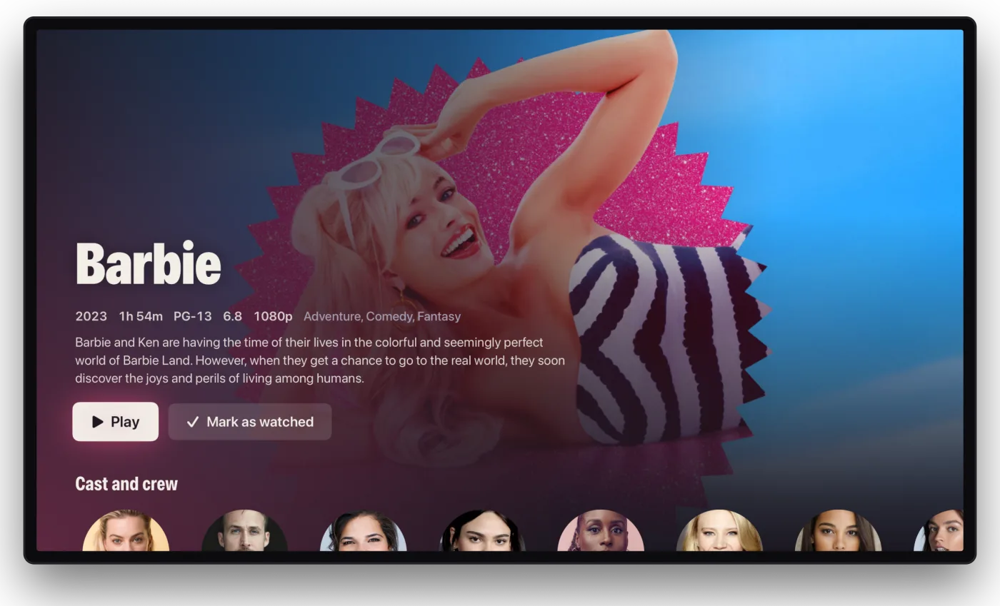

If you have a 4K HDR television and a soundbar or receiver, you want the picture and sound to arrive as they are in the file. Flexarr is built to do that on Apple TV, without converting anything. This page explains what reaches your TV, and the few settings on the Apple TV itself that make the difference.

> **Note**
> The Apple TV app isn't on the App Store yet. Until it is, you can [install it from Xcode](apple-tv-xcode.md).

## Set up the Apple TV first

These are Apple's own settings, in the Apple TV's **Settings › Video and Audio**. They matter more than anything in Flexarr.

1. **Format:** set it to the best your television supports. Apple recommends **4K SDR** (or **4K SDR 60Hz**) when you turn on matching below, so menus look right and HDR switches on only for HDR films.
2. **Match Content › Match Dynamic Range:** turn this on. The Apple TV then switches the television into HDR10, HLG or Dolby Vision to suit each film, and back again afterwards.
3. **Match Content › Match Frame Rate:** turn this on too. Films shot at 24 frames a second then play at 24, without judder.
4. **Audio Format:** leave this on its automatic setting so the Apple TV sends Dolby Atmos to equipment that takes it. If Atmos isn't showing on your soundbar or receiver, check here that Dolby Atmos is available.

Flexarr follows Match Content: when it's on, the Apple TV switches mode for each title Flexarr plays.

> **Tip**
> Without Match Dynamic Range, an Apple TV set to a fixed Dolby Vision output has no HDR10 mode. A plain HDR10 film may then be converted to SDR when it reaches the Apple TV as a stream from the server. Turning on Match Dynamic Range avoids this.

## HDR: what reaches your TV

With **Play files directly** on (the default on Apple TV, iPhone and iPad), the Apple TV plays the file itself. HDR10, HLG and Dolby Vision reach the television untouched.

With **Play files directly** off, the server [repackages](playback-and-transcoding.md) the original picture into a stream without re-encoding it. Here's what the television gets:

| In the file | On the television |
| --- | --- |
| HDR10 | HDR10, as it is |
| HLG | HLG, as it is |
| Dolby Vision profile 5 | Dolby Vision, on a Dolby Vision television |
| Dolby Vision profile 8.1 | Dolby Vision on a Dolby Vision television, otherwise HDR10 |
| Dolby Vision profile 7 (UHD Blu-ray) | Its HDR10 base layer |
| HDR10+ | HDR10, with its HDR10+ scene-by-scene metadata kept for televisions that use it |

A film's details say **HDR10+** when its file carries HDR10+, and **Dolby Vision, HDR10+** when it has both.

HDR is only converted to SDR when it has to be: when the television doesn't show HDR, when the stream is limited in size (see **Limit each stream to** in [Playback and transcoding](playback-and-transcoding.md)), or when the video itself has to be converted.

On iPhone and iPad, HDR shows on screens that support it.

## Sound: Atmos, TrueHD and DTS

How the sound reaches your equipment depends on what's in the file.

### Dolby Atmos in Dolby Digital Plus

This is the kind of Atmos you'll find on most streaming-service releases. It reaches the Apple TV intact and signalled as Atmos, ready for an Atmos receiver, soundbar or HomePods.

### TrueHD, DTS-HD Master Audio and PCM

The Apple TV can't play these as they are, so Flexarr makes sure nothing is lost on the way.

- **Play files directly on, Lossless surround on:** the app decodes the soundtrack and sends it as multichannel PCM over HDMI. Use this with a receiver or an eARC soundbar that accepts it.
- **Play files directly on, Lossless surround off:** they're sent as Dolby Digital Plus, which any soundbar or receiver plays.
- **Play files directly off:** the server sends them as lossless FLAC, up to 7.1, instead of squeezing them into 5.1.

Plain DTS is decoded with nothing more lost on the way.

> **Note**
> TrueHD soundtracks with Atmos currently play as lossless surround without Atmos's height channels. Keeping them is on the [roadmap](https://github.com/danleach-glitch/flexarr/blob/main/docs/roadmap.md).

### Lossless surround

**Lossless surround** comes on by itself when the Apple TV is connected to a receiver or soundbar that takes it. To change it, open Flexarr's **Settings › Playback** on the Apple TV: it's under **This Apple TV**, while **Play files directly** is on. The iPhone and iPad app has the same switch, for AirPlay or a connected display.

Turn it off if your television is plugged straight into a soundbar over ordinary ARC (not eARC), or if you hear nothing on TrueHD or DTS films with it on.

### Dialogue boost and night mode

The player's audio menu, and **Settings › Playback**, have three sound settings that each device keeps for itself:

- **Dialogue boost** (Low, Medium or High) raises the centre channel, where the voices are, and the speech frequencies.
- **Night mode** squeezes loud and quiet together, so explosions don't wake the house and whispers stay audible. **On a schedule** turns it on between set times, even in the middle of a film.
- **Speakers** folds the sound to **Stereo** or **5.1**. **Auto** plays every channel your equipment takes; leave it there for headphones, so the iPhone's Spatial Audio gets the whole mix.

On Apple TV and iPhone they need **Play files directly**. While any is on, Atmos plays without its height channels, so leave them off (and **Speakers** on **Auto**) for the full Atmos. Over AirPlay the sound plays as it is. The web has them too, for live TV as well, except in Safari.

## Watching away from home

With a quality limit set in **Settings › Streaming**, anything above it is converted down. Lossless sound becomes compressed and HDR becomes SDR, because neither fits through a small connection. See [Away from home](away-from-home.md).

## Other screens

- **iPhone and iPad:** surround is mixed down for headphones and the speakers, and passed on over AirPlay.
- **Web browsers:** fine for a quick watch, but use the Apple TV for HDR and surround.
- **Live TV:** channels that broadcast Dolby Digital or Dolby Digital Plus come through as 5.1 on Apple TV, iPhone and iPad at home. See [Live TV and recording](live-tv.md).

## Checking what you're getting

While something plays on the Apple TV, bring up the player's controls. The line in the corner says what's playing, for example "Original HEVC (Dolby Vision), repackaged, lossless FLAC 7.1 sound", or the resolution and sound followed by "Original" for a file played as it is. Your television's and receiver's own info screens confirm what they're receiving.

If HDR or Atmos isn't coming through, check the Apple TV's Match Content and Audio Format settings first, then [Troubleshooting](troubleshooting.md).
