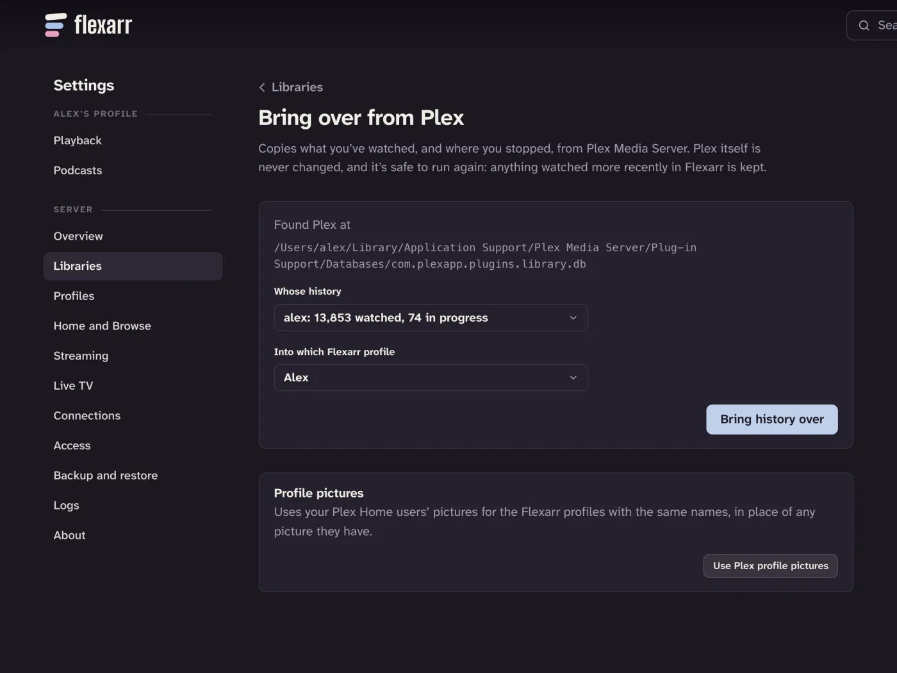

If you've been using Plex Media Server, Flexarr can copy across what you've watched and where you stopped, so Continue Watching and the watched ticks pick up where you left off. Plex itself is never changed: Flexarr takes a private copy of Plex's database, reads it, and deletes the copy.

## What comes over

- **Watched films and episodes**, with how many times each was played.
- **Resume points** for anything part-watched, so it shows in Continue Watching.
- **Profile pictures**, if you use Plex Home (a separate button, below).

Each Plex user's history goes into the Flexarr profile you choose, so the household's histories stay apart.

## What doesn't

- **Music.** Only films and episodes are brought over.
- **Files Flexarr doesn't have.** Titles are matched by the file on disk, not by name. If a file Plex knows about isn't in one of your Flexarr libraries, it's skipped and counted in the summary.
- **Anything else in Plex**: playlists, collections, ratings, server settings and users. Create profiles in Flexarr yourself ([Profiles](profiles.md)).

## Before you start

Flexarr reads Plex's database file, `com.plexapp.plugins.library.db`, so it has to be able to see it.

- **Plex on the same computer.** Flexarr looks in the usual places on a Mac, on Linux and on Windows, and normally finds it without help.
- **Plex in Docker, or Flexarr in Docker.** Make Plex's data folder visible to Flexarr, for example by mounting it into Flexarr's container read-only, then give Flexarr the full path to the database file when it asks. The file sits in Plex's data folder under `Plug-in Support/Databases/`.
- **Plex on a different computer.** Copy its `Plug-in Support/Databases` folder to the Flexarr machine and point Flexarr at the copied `com.plexapp.plugins.library.db`.

> **Note** Flexarr only accepts a path to a file named `com.plexapp.plugins.library.db`. It won't read any other file you point it at.

Matching is by file path, so your libraries need to be set up in Flexarr first, with their scans finished. If Plex saw your media under different paths from Flexarr (common when one of them runs in Docker), add a path mapping in **Settings › Connections › Path mappings** before importing; Flexarr applies the same mappings to Plex's paths. See [Media paths](media-paths.md).

## Bring the history over

You need the main profile for this.

1. In the web app, open **Settings › Libraries** and choose **Bring over from Plex**.
2. Flexarr says where it found Plex. If it says Plex wasn't found, type the full path to `com.plexapp.plugins.library.db` and choose **Look there**.
3. Under **Whose history**, pick the Plex user. Each is listed with how many titles they've watched and how many are in progress.
4. If you have more than one Flexarr profile, choose one under **Into which Flexarr profile**. It starts on the main profile.
5. Choose **Bring history over**.

When it's done, a summary says how many titles were matched, how many are now watched, and how many are ready to resume. It also says how many files Plex knows about that aren't in your Flexarr libraries.

Repeat steps 3 to 5 for each person, picking their Plex user and their Flexarr profile each time.

## Running it again is safe

You can run the import as often as you like. For each title, the most recent viewing wins: if you've watched something in Flexarr since you last watched it in Plex, Flexarr keeps its own, and the summary tells you how many were left alone. Play counts never go down.

This makes it easy to try Flexarr alongside Plex for a while and bring over whatever you've watched in Plex in the meantime.

> **Tip** If a lot of files come up as not matched, check your path mappings, then rescan the libraries and run the import again.

## Profile pictures

Under the import there's a **Profile pictures** panel. **Use Plex profile pictures** takes each Plex Home user's picture and puts it on the Flexarr profile with the same name, replacing any picture it has. Plex's owner is matched to the main profile if no profile shares their name.

This step does go online: Flexarr reads Plex's own sign-in from its settings file and makes one request to plex.tv for the list of Home users and their pictures. The sign-in isn't stored. If Flexarr can't find the sign-in, Plex Media Server needs to be on this machine (or its data folder visible to Flexarr) and signed in to plex.tv.

If a Plex user has no matching profile, the summary names them. Add a profile with that name in **Settings › Profiles** and run it again.
