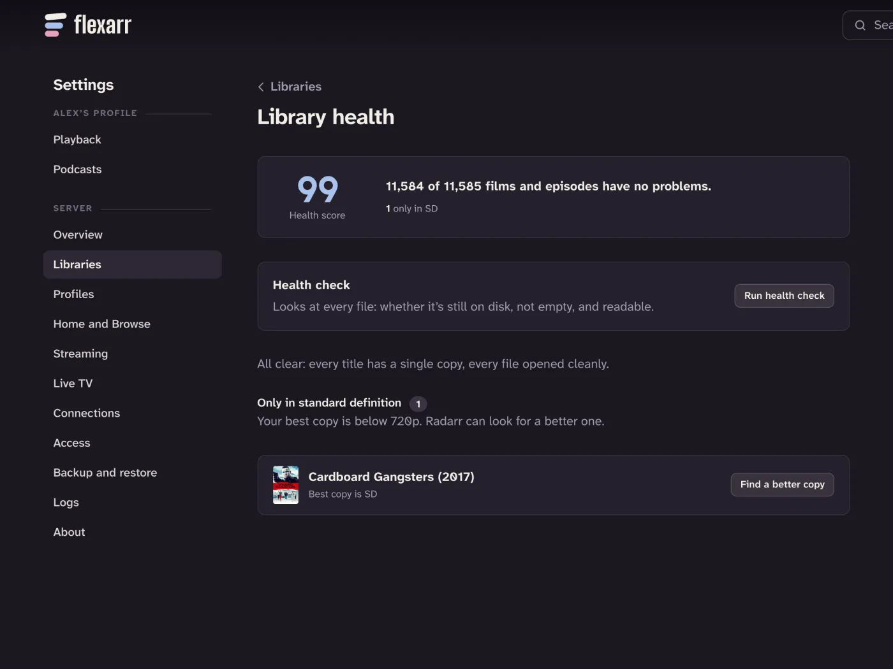

Library health is a check-up for your films and TV. It shows what's wrong, how much space spare copies take, and a button to fix each problem, usually by asking Sonarr or Radarr to do the work.

Open it in the web app from **Settings › Libraries › Library health**, as the main profile. The **Overview** page in Settings links to it too.

## The health score

At the top is a score out of 100: the share of your films and episodes with nothing wrong. Next to it is a breakdown of what's affecting the rest, such as spare copies, unreadable files or missing artwork.

Groups with nothing in them are left out, and a line underneath says what's all clear ("every title has a single copy", "every film has an HD copy").

## Spare copies

Sometimes a film or episode ends up with more than one file: an upgrade that didn't replace the old one, or the same file in two folders. **Spare copies** lists each one, how many copies it has and how much space the spares use. The total you'd free is in the group's description.

- **Remove spares** on a title deletes its extra files.
- **Remove all spare copies** does the whole list, after asking first, with a progress bar.

Flexarr always keeps two copies safe: the best one (highest quality), and the one Sonarr or Radarr are tracking. Usually they're the same file. When they're not, both stay and the summary tells you; open the title's row to see each copy with its resolution, codec and size, and use **Delete this copy** on the one you don't want. Copies that are the same file twice are marked **Identical**.

> **Important** Removing spares deletes files from your disk. It can't be undone.

## Run a health check

The **Health check** panel looks at every file: whether it's still on disk, whether it's empty, and whether it can be read. Choose **Run health check** and it works through your library in the background, with a progress bar. Problems are listed under **Missing from disk**, **Empty files** and **Still unreadable**, each with **Search again** to have Sonarr or Radarr fetch it again.

## Files that can't be read

Files Flexarr couldn't open when it scanned them are listed under **Files that can't be read**, with the reason. This is usually a damaged or unfinished download. **Get a new copy** asks Sonarr or Radarr to search for the title again; a fresh copy fixes playback.

## Standard-definition films

**Only in standard definition** lists films whose best copy is below 720p. **Find a better copy** asks Radarr to search for the film again, so it can upgrade it within the quality profile you've set in Radarr.

When Sonarr or Radarr are already fetching a new copy, the row shows how far along it is ("Downloading 45%") instead of the button.

## Check these matches

Films and shows that Sonarr and Radarr don't manage get their details by searching for the folder's name. That can find the wrong title: an older show with the same name, or a remake. They're listed under **Check these matches**.

- If a match is right, choose **Ignore**. It leaves the list and stays as it is.
- If it's wrong, choose **Fix match** (below).

## Missing artwork

Titles with no poster or details are listed under **Missing artwork**. Artwork comes from Radarr and Sonarr, so if they aren't connected, connect them in **Settings › Connections** ([Connect Sonarr, Radarr, Lidarr and Seerr](connect-arrs.md)). If they are, the title wasn't found: fix its match, or rename its folder to the form `Title (Year)` and rescan.

## Fix match

**Fix match** puts right a film or show that's been matched to the wrong title. It's on each row in Check these matches and Missing artwork, and in the **⋯** menu on any film's or show's page (main profile only).

1. Choose **Fix match**. The dialog shows the full path of the film's files, or the show's folder, so you can see what's being matched.
2. Search for the right title. Try the title as it was first released, or add the year.
3. Pick it. Each result says whether it's the **Current match**, already in Sonarr or Radarr, or would be added to them.

Flexarr keeps your choice through every later refresh. If the title wasn't in Sonarr or Radarr, fixing the match adds it there using the folder it's already in, so they manage it from then on. Fixing a match needs Sonarr (for shows) or Radarr (for films) connected.

> **Note** If Sonarr or Radarr already use that folder for a different title, Flexarr won't change it for you. Remove that title in Sonarr or Radarr (keeping its files), then fix the match again.

To undo a fix, open Fix match again and choose **Match automatically again**.

## Deleting a title

To delete a film, show or episode, open its page, then **⋯ › Delete…** (main profile only). The dialog says who'll do the deleting before you confirm:

- **A film Radarr manages:** Radarr deletes the film's files from disk and stops tracking it.
- **A show Sonarr manages:** Sonarr deletes every episode's files and stops tracking the show.
- **An episode:** Sonarr deletes the episode's file and stops downloading it, so it doesn't come back.
- **A title neither manages:** Flexarr deletes the video files itself and lists them first. It also removes folders left empty, but never a library's own folder or anything outside it.

If Sonarr or Radarr can't be reached or refuse, nothing is removed from Flexarr either.

> **Important** Deleting can't be undone. Back up anything you want to keep first.

## Folders on hold

If a drive or network share isn't connected when Flexarr scans, its titles aren't removed; the folder is put **on hold** instead, and your watch history is kept. Held folders are listed in Library health with the reason, such as "The folder isn't there. Is its drive or share connected?". Reconnect the drive and the next scan carries on as normal.

If you really did empty the folder on purpose, choose **Confirm removal** and its titles go.
