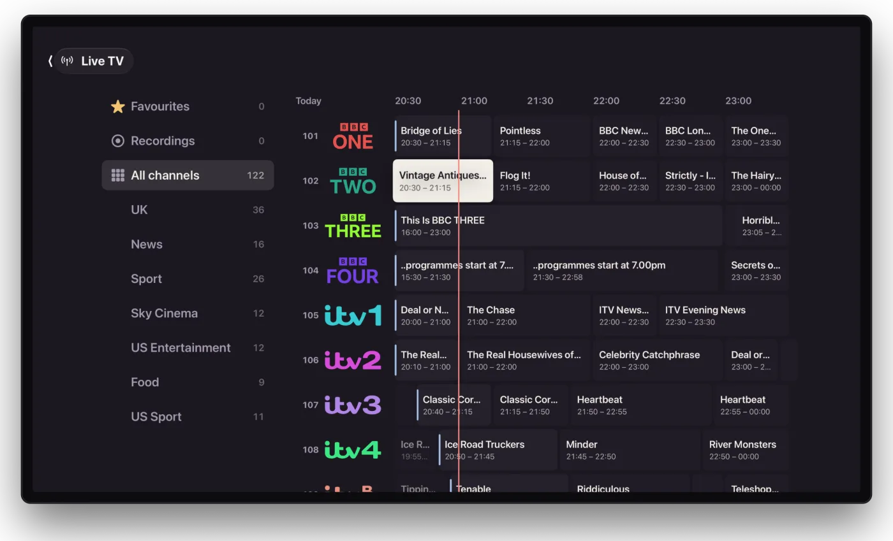

Flexarr can show TV channels next to your films and shows, with a programme guide, favourites, pause and rewind, and recording. It doesn't come with any channels. You bring your own, through Dispatcharr.

Live TV is on the web, Apple TV, iPhone and iPad. Kids profiles don't have it, and a profile with an age limit sees only the channels the main profile picks under **Channels for kids** in **Settings › Live TV**.

## What you need

Flexarr reads channels and their guide from [Dispatcharr](https://github.com/Dispatcharr/Dispatcharr), a free, self-hosted app that gathers TV sources into one channel list. Dispatcharr is the only source Flexarr supports. You can't give Flexarr an M3U playlist or XMLTV guide address directly; add them to Dispatcharr instead.

Into Dispatcharr you can bring:

- **Your own tuner**, such as an HDHomeRun on an aerial or cable connection, for free-to-air channels.
- **An IPTV service you're entitled to use**, given to Dispatcharr as an M3U playlist with an XMLTV guide.

Setting up Dispatcharr itself is covered in its own documentation. Once it has channels and a guide, carry on below.

> **Important**
> Only use sources you have the right to watch. Flexarr doesn't provide, find or recommend channels.

## Connecting Dispatcharr

First, in Dispatcharr:

1. Add a user for Flexarr, at **Streamer** level.
2. Give it a long, random XC password. This works as Flexarr's key. It can only list and play channels, never sign in to Dispatcharr or change anything.
3. Give that user the channels you want in Flexarr.

Then in Flexarr, as the main profile:

1. Open **Settings › Connections** and edit **Dispatcharr**.
2. Fill in **Address** (for example `http://localhost:9191`), **User name** and **Key (XC password)**.
3. Choose **Test**. It should say how many channels it found and how many connections your source allows at a time. Then choose **Save**.

The channels and guide come in straight away. The guide refreshes every six hours, and channels you add or remove in Dispatcharr show up within five minutes. **Refresh channels and guide** fetches them now.

Channel logos come from a community logo collection where it has a match, and from Dispatcharr where it doesn't.

## Watching

**Live TV** sits with your libraries.

- **On the web**, **On now** lists every channel with what's on, how far through it is and what's next, filtered by group. The **Guide** shows the next six hours, or up to a day, as a grid.
- **On Apple TV**, the guide has categories down the left and channels with three hours across. What's on now plays; anything later shows what it is.
- **On iPhone and iPad**, Live TV is a list of channels. The **Guide** button turns it into a grid, and **List** goes back.

In the player, previous and next change channel. The **Channels** button lists every channel over the picture, with **Last watched** at the top so flipping between two is one press. On Apple TV, the **Guide** button opens the guide over the picture while the channel carries on behind it.

Home has a Live TV row too, starting with the channel you watched last, then your favourites.

### Favourites

Star the channels you watch most. Each profile has its own, and Live TV opens on them.

- **Web:** select the star on a channel.
- **Apple TV:** press and hold a channel or programme.
- **iPhone and iPad:** swipe right on a channel, or press and hold.

### Pause and rewind

You can pause a channel and rewind it. The timeline shows the time of day, **LIVE** or how far behind you are, and a button to jump back to live.

The server keeps the rewind window while anyone is watching a channel, so you can rewind to when the channel was first put on, up to the limit. Set the limit in **Settings › Live TV › Rewind up to**, from 15 minutes to 4 hours (1 hour to start with). It takes about 2 GB of space an hour for HD.

### Picture and sound

Channels that are already H.264 play as they come. Others (interlaced, MPEG-2 and HEVC) are converted, and interlaced channels are made smooth at 50 frames a second. On Apple TV, iPhone and iPad at home, channels broadcasting Dolby Digital or Dolby Digital Plus come through as 5.1. The web player is stereo.

One channel is shared by everyone watching it, so a source that allows one connection can still serve the whole house.

## Watching away from home

Away from home, over [Tailscale](away-from-home.md) or the internet, channels come in a reduced version: at most 720p at about 2.5 Mbps, in stereo, so they keep playing on hotel Wi-Fi or a phone's data. At home they play as they come. Someone at home and someone away can watch the same channel at once.

## Recording

### Setting a recording

In the guide, choose a programme (on Apple TV, press and hold it), then:

- **Record** for this showing, or
- **Record series** for every showing. On the web you can choose **On any channel** and **New episodes only**.

A programme set to record has a red dot, and one a series covers has two. While it's recording it shows a **REC** badge.

**Live TV › Recordings** lists what's coming up, the series being recorded (keep all of them or only the latest few), what's been recorded, and why anything didn't record.

### Where recordings go

Recordings are saved as MKV files, with the picture and every soundtrack as they came, nothing converted. They're named like TV episodes, for example `Show/Season 2/Show - S02E05 - Episode.mkv`, or by date when the guide doesn't number them.

By default they go in a `DVR` folder at the top of the drive your TV library is on. To choose another, set **Folder** in **Settings › Live TV**. Recordings play like anything else in Flexarr, with resume and Continue Watching, from **Live TV › Recordings**.

### Recording settings

In **Settings › Live TV**:

- **Start early** and **Run on**: broadcasts drift, so recordings start a minute early and run five minutes on unless you change them.
- **Keep free on the drive**: no new recording starts with less than this free (100 GB to start with). The Recordings list says when that's why.
- **Channels at once**: how many channels can be open together, for watching and recording combined. **As Dispatcharr says** uses the limit your source reports.

### When channels run out

Watching and recording share your source's connections. Watching and recording the same channel counts once. A recording takes priority: if someone is watching another channel when it's due, that channel stops with a message. If every connection is recording, choosing another channel tells you what's recording and offers to watch that instead, or stop the recording. Recordings that would need more connections than you have are flagged as clashing when you set them.

A recording under way when Flexarr restarts carries on afterwards.
