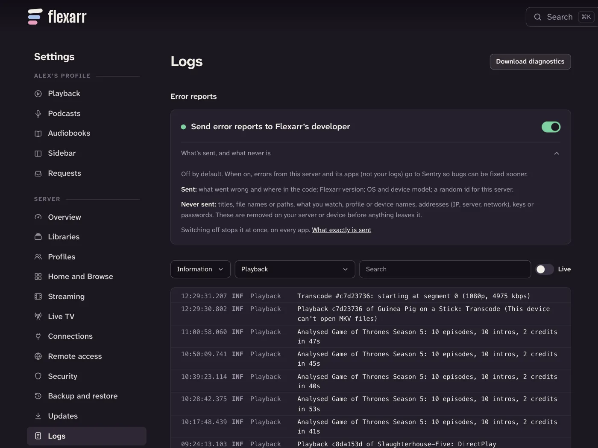

Flexarr keeps a log of what the server and its apps do. When a film won't play, a scan stalls or Sonarr can't be reached, the log usually says why. It stays on your server: nothing in it is sent anywhere unless you download it and send it yourself.

## Reading the log

Open **Settings › Logs** in the web app, as the main profile with settings unlocked. The newest entries are at the top. Select an entry to see its details.

To narrow it down:

- **Minimum level**: show only warnings and errors, say, or everything down to Debug.
- **Area**: one part of Flexarr, such as Playback or Library scans, or **All areas**.
- **Search**: any text in the entry.
- **Live**: turn it on to watch new entries arrive as they happen. It's handy while you reproduce a problem.

**Load older** at the bottom goes further back.

## Following one playback

Every time something starts playing it gets a short id, such as `3f9a1c07`. The server's lines about that playback show it as `#3f9a1c07`, and the Apple TV, iPhone and iPad apps attach the same id to what they report. Open an entry and select its `playbackId` to see only that playback: the whole story, from the server and the device, from start to finish.

## Turning up the detail

Under **Levels**, the **Default level** applies to the whole server. Each area can be set to log more (**Debug**) or less (**Warning**) than that. Changes apply straight away, with no restart.

| Area | What it covers |
| --- | --- |
| General | Everything not below, including startup |
| Playback | Direct play, transcoding, ffmpeg, downloads to phones |
| Library scans | Scanning, reading files, imports |
| Sonarr, Radarr, Seerr and Bazarr | Calls to the \*arr apps, Seerr and Bazarr |
| Metadata and artwork | TVmaze, TMDB, artwork |
| Live TV | Dispatcharr channels, the guide, recordings |
| Podcasts | Feeds and episode downloads |
| Notifications | Push notifications |
| Web requests | One line per request. Failures show at Information; set Debug to see every request |
| Apps and browsers | What the apps and browsers report |

> **Tip** Chasing a problem? Set its area to Debug, make the problem happen again, then set the area back to Default so the log doesn't fill up.

## What the apps send

- **Automatically:** warnings and errors from the Apple TV, iPhone and iPad apps, and errors from the web app. They appear under the **Apps and browsers** area, named after the device.
- **When you ask:** **Send diagnostics** sends a device's recent log in full. On Apple TV, iPhone and iPad it's in the app's **Settings › Server › Send diagnostics**. Add a note saying what happened and roughly when, then send.

Diagnostics go to your server and nowhere else. They're listed under **Diagnostics from apps** at the bottom of the Logs page, with the device, app version, profile and when they arrived, and a **Download** button for each.

## Download diagnostics

**Download diagnostics**, at the top of the Logs page, makes a zip for looking into a problem. It holds:

- the server's logs, with titles, file names, device names and IP addresses in them
- diagnostics sent from the apps
- your settings (`config.json`), with every key and password blanked but the addresses of Sonarr, Radarr and your other connections, your path mappings and the server's known host names left in
- a description of the server: Flexarr version, operating system, ffmpeg, free space, your libraries' names and how many titles, files and profiles there are

So it says a lot about your home network and your library. Send it privately to whoever is helping you, rather than attaching it to a public GitHub issue.

## What's taken out

API keys, passwords, sign-in tokens and playback session ids are removed before anything is written: keys and passwords become `***`, and long tokens become a short `#id`. That's true of the server's log files, what the apps send and the diagnostics zip.

Everything else stays, including titles, file names and addresses, because they're what you need to work out what went wrong.

## How long logs are kept

Logs are kept for **14 days**, and the log folder is capped at **100 MB**, oldest files first. Change both under **Retention** on the Logs page: **Keep for (days)** and **Largest size (MB)**.

The server starts a new file each day (`flexarr-20261027.log`, say), and another if one day's passes 10 MB. Each line is a JSON object, so other tools can read them.

| Install | Log folder |
| --- | --- |
| Mac | `~/.flexarr/logs` (in the Mac app, coming to the Mac App Store: **Show Logs** in its menu) |
| Docker | `/config/logs` (and `docker logs flexarr`) |
| Anywhere else | `logs` in Flexarr's data folder, or set `Flexarr__Logs__Directory` |

## Error reports

You can choose to send error reports to Flexarr's developer, so bugs get found and fixed sooner. **It's off unless you turn it on.**

The switch, **Send error reports to Flexarr's developer**, is at the top of the Logs page. One switch covers the server and every app and browser connected to it, and turning it off stops it everywhere at once. **What's sent, and what never is** opens the full list.

- **Sent**, only when something goes wrong: what went wrong and where in Flexarr's code, the Flexarr version, the operating system and device model, and a random id for your server that isn't linked to you.
- **Never sent:** titles, file names or paths, what anyone watches, your logs, profile and device names, addresses (IP, server, network), keys and passwords.

Reports are cleaned on your server or device before they leave it, and one that can't be cleaned isn't sent. They go to Sentry, which stores them in the EU and deletes them after at most 90 days.

See also [Troubleshooting](troubleshooting.md), which starts most fixes from this page.
