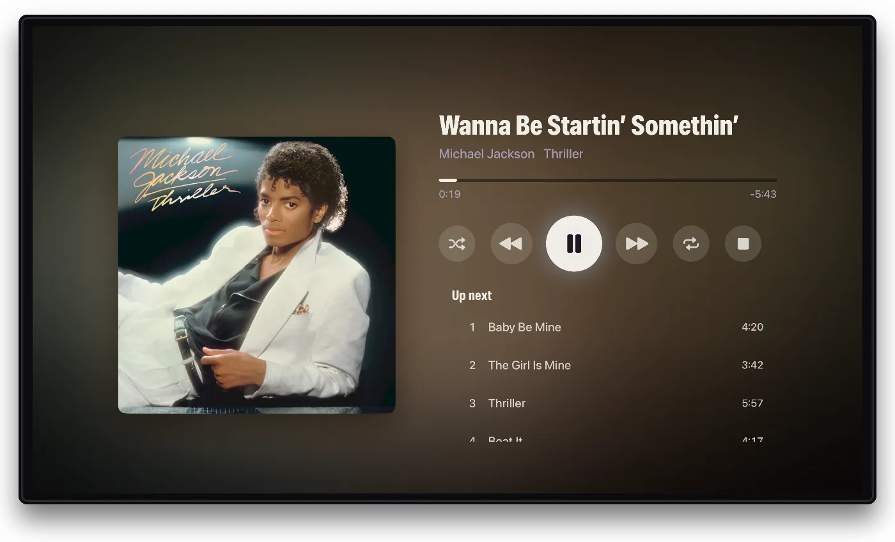

Flexarr plays your music library like a streaming app: artists with their pictures, albums on shelves, a queue, playlists and lyrics. It's at its fullest in the web app, with the Apple apps covering everyday listening.

## Setting up a music library

1. In **Settings › Libraries**, choose **Add library**, pick **Music** and point it at your music folder.
2. If you use Lidarr, connect it in **Settings › Connections**. See [Connect your \*arrs](connect-arrs.md).

Lidarr isn't required, but it makes a big difference. With it, artists and albums take their names, years, descriptions and artwork from Lidarr: the artist's own picture rather than an album cover, and a cover for every album even when the files carry none. An artist's page shelves releases into **Albums**, **EPs and singles**, **Live and compilations** and **Other**. Without Lidarr, Flexarr reads everything from the files' tags.

A track by someone other than the album's artist, such as a duet or a compilation track, shows its own artist. Compilations without an album artist are filed under **Various Artists**.

## Playing and the queue

Every artist, album and playlist has **Play** and **Shuffle**, which open Now Playing. An artist's Play runs through their whole catalogue, oldest album first. Picking a single song leaves you on the list.

**On the web**, the now-playing bar stays with you as you browse. Click its cover for Now Playing across the whole window: a big cover, the controls and what's up next, with light in the cover's colours moving with the music. Escape closes it. Tracks and albums have **Play next** and **Add to queue** in their menus. The queue panel above the bar lets you drag tracks into order, remove them, clear the lot or skip to any track. The queue and your place in it survive a page reload.

**On Apple TV, iPhone and iPad**, the player has next and previous, seeking, shuffle and repeat, and shows the whole queue. Music carries on while you browse, and playing a movie pauses it until you're done.

## Now Playing on Apple TV

While music plays, a **Now Playing** entry appears in the sidebar, with the cover, controls and the queue, and a bar along the bottom of the screen that goes away a few seconds after the music is paused. Play/pause on the remote works from anywhere in the app. **Stop** ends the music and takes the bar and Now Playing away until you play something else.

Behind Now Playing, light in the cover's colours moves in time with the music. Turn it off with **Settings › Playback › Music visualiser**.



## On iPhone and iPad

A mini-player sits above the tab bar. Tap it for the full Now Playing sheet, with the cover, scrubber, controls, queue and AirPlay. The lock screen, Control Center and a paired Apple Watch control playback too.

## Playlists

Each profile has its own playlists. On the web, choose **Add to playlist** from a track's, album's or artist's menu, and manage them from the **Playlists** page: rename, reorder by dragging, or delete. Playlists play on Apple TV, iPhone and iPad as well, and appear in a **Your playlists** row on Home.

Making and editing playlists is on the web for now.

## Lyrics

Flexarr shows lyrics on the web, Apple TV, iPhone and iPad. On the web, they're in a **Lyrics** panel under the album's track list. In the apps, there's a **Lyrics** button on Now Playing.

Timed lyrics follow the song with the current line lit, and choosing a line jumps there.

Flexarr doesn't fetch lyrics from the internet. It reads them from your files, in this order:

1. An `.lrc` file beside the track, with the same name (timed lyrics).
2. Lyrics stored in the track's own tags.
3. A `.txt` file beside the track, with the same name.

```text
Brothers in Arms/01 - So Far Away.flac
Brothers in Arms/01 - So Far Away.lrc
```

Any tool that saves `.lrc` files next to your music works.

## Made for you, and radio

These are on the web for now.

- **Daily mixes:** up to four for each profile, built from what it plays, grouping artists who share genres ("Rock Mix"). About 40 tracks each, the same all day and fresh tomorrow. They appear once a profile has played twenty or so tracks, in a **Made for you** row on Home and in a music library's Browse view.
- **Artist radio:** start it from an artist's page. It's a station of about fifty tracks from that artist and others sharing their genres.
- **Home rows:** **Recently played**, **Most played**, **More from artists you play** and **New albums**. Move them or turn them off in **Settings › Home & browse**.

## Gapless, crossfade and volume

The web player loads the next track before the current one ends, so the switch between them takes a few milliseconds. Live albums and DJ mixes flow on almost without a gap.

In the web app, **Settings › Playback › Music in this browser** has three more:

- **Crossfade:** **Off**, or fade the next track in over 2 to 12 seconds as the current one ends.
- **Normalise volume:** on by default. It uses ReplayGain (and Opus R128) tags in your files to level loudness, so a quiet album and a loud one play at about the same volume. Tracks without these tags play as they are; a tagging tool can add them.
- **Visualiser:** the moving light behind Now Playing.

These are kept per browser, since speakers and taste differ by room.

## Albums offline

On iPhone and iPad, every album and playlist has a **Download** button. Tracks the phone plays as they are (AAC, ALAC, MP3, FLAC, WAV and AIFF) are kept as they are. Anything else is converted to AAC. Downloaded tracks carry a green arrow and play with no connection. See [Downloads](downloads.md).
