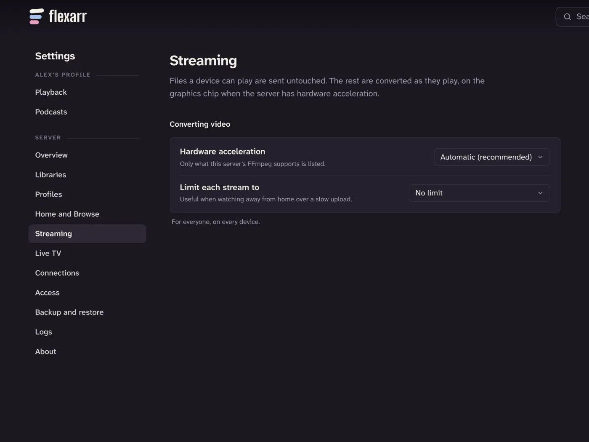

Every time you press Play, Flexarr works out the least it has to do for that screen to show the file. Most of the time that's nothing at all. This page explains the three ways a file can reach you, what your server needs for the hardest of them, and how to see which one is happening.

## Three ways a file can play

### Direct play: the file as it is

When a device can open the file and decode its picture and sound, Flexarr sends the file untouched. The server does no more work than a file share would. This is the best case: full quality, and the lightest load on the server.

On Apple TV, iPhone and iPad, **Play files directly** is on by default. With it, the app opens almost any file itself, including MKV and AVI files and AV1, VC-1, MPEG-2 and XviD video, decoding in software what the hardware can't. HDR and Dolby Vision stay as they are. The server only steps in for the few files the app can't open.

### Repackaging: same picture, new wrapping

Sometimes the picture is fine but the file around it isn't. A typical case is an MKV with H.264 or HEVC video, when **Play files directly** is off. Flexarr then copies the original picture into a stream the device accepts, cut at the file's own keyframes. Nothing is re-encoded, so you lose no quality, HDR and Dolby Vision included, and the server barely notices. Starting and seeking stay instant.

MKV files can be repackaged straight away. Other files are indexed in the background the first time they're played, and repackage from the next time.

### Transcoding: converting as it plays

When the device can't decode the picture, or the stream has to be smaller, Flexarr converts the file as you watch, to H.264 video. It converts only what you're about to watch, so you can still jump anywhere in a film instantly. HDR is converted to SDR on the way.

Converting is real work for the server. By default it converts at most three videos at once. Beyond that, the player says the server is busy rather than slowing everyone down.

## Hardware acceleration

Converting video on the server's graphics chip is much faster and lighter than on its processor. Choose how in **Settings › Streaming › Hardware acceleration**. This page belongs to the main profile, the one that manages the server.

| Choice | For |
| --- | --- |
| **Automatic (recommended)** | Apple VideoToolbox on a Mac. Anywhere else, Automatic means the processor, so pick one of the options below. |
| **Apple VideoToolbox** | Macs. Automatic already picks this. |
| **VA-API (Intel and AMD on Linux)** | Intel and AMD graphics on Linux. A **VA-API device** field appears, set to `/dev/dri/renderD128` unless you change it. |
| **Intel Quick Sync** | Intel processors with built-in graphics. |
| **NVIDIA NVENC** | NVIDIA graphics cards. |
| **Off: convert on the CPU** | No graphics chip, or for troubleshooting. A **Software speed** choice appears. |

Only the options your server's copy of FFmpeg was built with are listed. Being listed doesn't prove the hardware is reachable, though. In Docker, for example, the container also needs the graphics device passed through to it. After changing this, play something that needs converting and check it starts (see **How to tell what's happening**, below).

> **Note**
> On a Mac, files whose video the graphics chip can't decode (old AVI and XviD files, VC-1) are decoded on the processor and still encoded on the graphics chip. You don't need to do anything.

### Without a graphics chip

With **Off: convert on the CPU**, **Software speed** offers **Fastest, lowest quality**, **Fast (recommended)** and **Slower, better quality**. Faster uses less of the server, at some cost to picture quality.

Converting video in software is demanding. A recent multi-core desktop processor can usually keep up with a 1080p stream or two. A low-power NAS processor may struggle with even one, and converting 4K or HDR in software is heavy for almost anything. If your server has no graphics chip, the good news is that Apple devices rarely need converting at all, thanks to **Play files directly** and repackaging.

## Limiting quality

**Settings › Streaming › Limit each stream to** caps every stream from the server: **No limit**, **20 Mbps**, **10 Mbps**, **4 Mbps (good for remote viewing)** or **2 Mbps**. A file above the limit is converted down to fit.

Use it when your home internet's upload is slow and people watch [away from home](away-from-home.md). Bear in mind it applies to every stream, at home too, and anything converted to fit loses HDR and lossless sound. At home on a decent network, **No limit** is best.

> **Note**
> Live TV is different: away from home, channels automatically come in a reduced version. See [Live TV and recording](live-tv.md).

In the web player, the quality button in the corner chooses **Best for this device**, **1080p**, **720p** or **480p** for what you're watching now.

## Settings that are per device

On Apple TV, iPhone and iPad, these live in the app's **Settings › Playback** under this device's own settings, not your profile's:

- **Play files directly**: on by default. Off, the server sends a stream instead and converts what the device can't play.
- **Lossless surround**: appears when **Play files directly** is on. See [HDR and Dolby Atmos](hdr-and-atmos.md).
- **Skip back and forward**: 10, 15 or 30 seconds.
- **Dialogue boost**, **Night mode** and **Speakers**: appear when **Play files directly** is on. See [HDR and Dolby Atmos](hdr-and-atmos.md#dialogue-boost-and-night-mode). The web keeps them in **Settings › Playback** under **Sound in this browser**, and Android under **This phone**.

## How to tell what's happening

- **Web player:** the quality button says **Original** when the file is playing as it is, and **Auto** when it's being converted.
- **Apple TV, iPhone and iPad:** with the player's controls showing, a line in the corner describes the stream. It ends in "Original" for a file played as it is, says "repackaged" when the original picture is copied, and gives a size and bitrate (such as "1080p H.264 at 10 Mbps") when it's converted.
- **Settings › Overview:** under **Watching now**, each stream is tagged **Original file** or **Converting to …**.

If something is converting that you didn't expect, check whether **Limit each stream to** is set, whether **Play files directly** is off on that device, and whether picture-based subtitles are on in the web player (they have to be burned into the picture). For more, see [Troubleshooting](troubleshooting.md).
