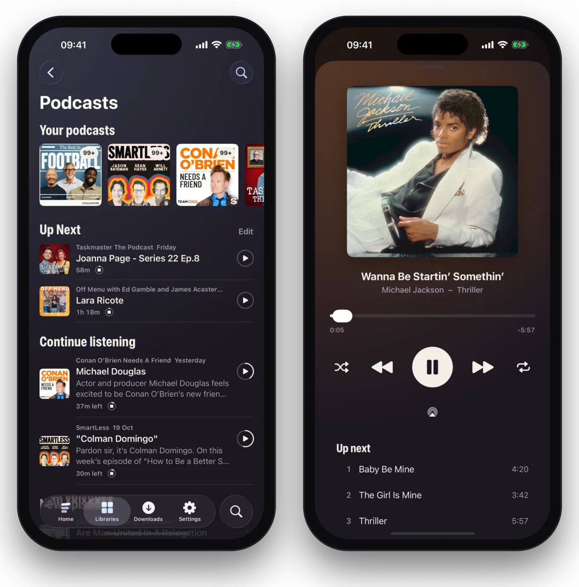

Podcasts are built into Flexarr. There's no library to add and nothing to set up: they sit with your libraries, and each profile follows its own shows. They're on the web, iPhone and iPad. They aren't on the Apple TV, and kids profiles don't have them.

## Finding shows

Open **Podcasts** and choose **Browse**.

- **Top charts**, by category, come from Apple's podcast directory.
- **Search** finds any show in that directory.
- **A feed's address** works too: paste it into the search box to add a show Apple doesn't list, such as a private or members-only feed.

Whose charts you see is set by the main profile in **Settings › Libraries**, under **Podcasts › Charts and search**. It starts as the server's own region.

## Following a show

Choose **Follow** on a show. It joins the row of shows you follow on the Podcasts page, and its newest episodes you haven't heard appear there and in a **New podcasts** row on Home.

Flexarr checks feeds by itself, more often for shows that publish often.

On a show's page:

- Unplayed episodes come first.
- **Newest first** or **Oldest first** sets the order. Oldest first suits shows heard in order, and Play then starts the oldest you haven't heard. A show you follow remembers its order.
- **Mark all as played** clears a back catalogue in one go.

## Listening

Episodes play in the same bar as music, and pick up where you left off on any device.

- **15 seconds back and 30 on**, on screen and on the lock screen.
- **Speeds** from 0.8× to 3×. Your profile's default is in **Settings › Podcasts › Speed**, and changing it in the player changes it there too.
- **Sleep timer** (the moon): stop after a set time, or at the end of the episode.
- **Notes** swaps the cover for the episode's notes and chapters. The chapter playing shows above the scrubber, with arrows to the next and the last.
- Now Playing says when the episode will end, at the speed it's playing.
- When an episode ends, the show's next one plays, or else the newest you haven't heard.

Episodes play through your server rather than straight from the podcast's host. That means they work [away from home](away-from-home.md) over Tailscale as they do at home, and podcast hosts don't see where each listener is.

## Up Next

Up Next is your own queue of episodes, shared between the web and your phone. Use **Play next** or **Add to Up Next** on any episode. Reorder or remove episodes on the Podcasts page, or in Now Playing on iPhone and iPad. An episode leaves Up Next once it starts playing.

Episodes you're part way through also show on Home, in **Continue watching or listening**, on the web, iPhone, iPad and Android. To leave them out, turn off **Books and podcasts in Continue watching** in **Settings › Playback**.

## Settings

Podcast settings belong to each profile.

**On the web**, **Settings › Podcasts**:

- **Show in the sidebar**: either way, Home has a New podcasts row.
- **Speed**.
- **Download new episodes** and **Episodes to keep**, for iPhone and iPad.

**On iPhone and iPad**, **Settings › Podcasts** has **Auto-download new episodes**, how many of the newest to keep, and **Speed**.

## Offline on iPhone and iPad

Download any episode to listen with no connection. Or turn on **Auto-download new episodes**: the newest unplayed episodes of every show you follow then download by themselves. Episodes you deleted yourself are never downloaded again by themselves.

A downloaded episode is deleted once you've heard it to the end or marked it played, whether you downloaded it or the app did. One finished on another device, such as the web, goes the next time the app catches up with the server.

Automatic downloads wait for Wi-Fi, unless you turn off **Automatic downloads on Wi-Fi only** in **Settings › Downloads**. They never use Low Data Mode. An episode you download by hand comes over mobile data too. What you hear offline counts once you're back online.

### The episodes folder on the server

To reach your phone, an episode is first fetched to your server, then the phone takes it and the server deletes its copy. It waits in the Podcasts **Episodes folder**, in **Settings › Libraries**. This starts as a folder in Flexarr's own data folder. If that's on a small drive, choose **Change** and pick a folder on your media drive instead.

## Bringing your shows over

Most podcast apps can export the shows you follow as an OPML file. In Flexarr on the web, use **Import** on the Podcasts page and choose that file. **Export** gives you an OPML file of your shows to take elsewhere.

## Notifications and widgets

On iPhone and iPad, Flexarr can tell you when a show you follow has a new episode, with buttons to play or download it. Turn this on in **Settings › Notifications**. There are widgets for **Continue listening** and **Up Next** too. See [Notifications and widgets](notifications-and-widgets.md).

## Siri

Siri plays podcasts on iPhone and iPad: "Play *The Rest Is History* in Flexarr" plays the episode you'd hear next. "Play the latest …", "What's new in my podcasts", "Add … to Up Next" and "Play my Up Next" work too. See [Siri and Shortcuts](siri-and-shortcuts.md).

## CarPlay

The iPhone app has a CarPlay view for podcasts, with Up Next, new episodes and your shows, plus speed and skips. It switches on once Apple approves Flexarr for CarPlay, which hasn't happened yet.
