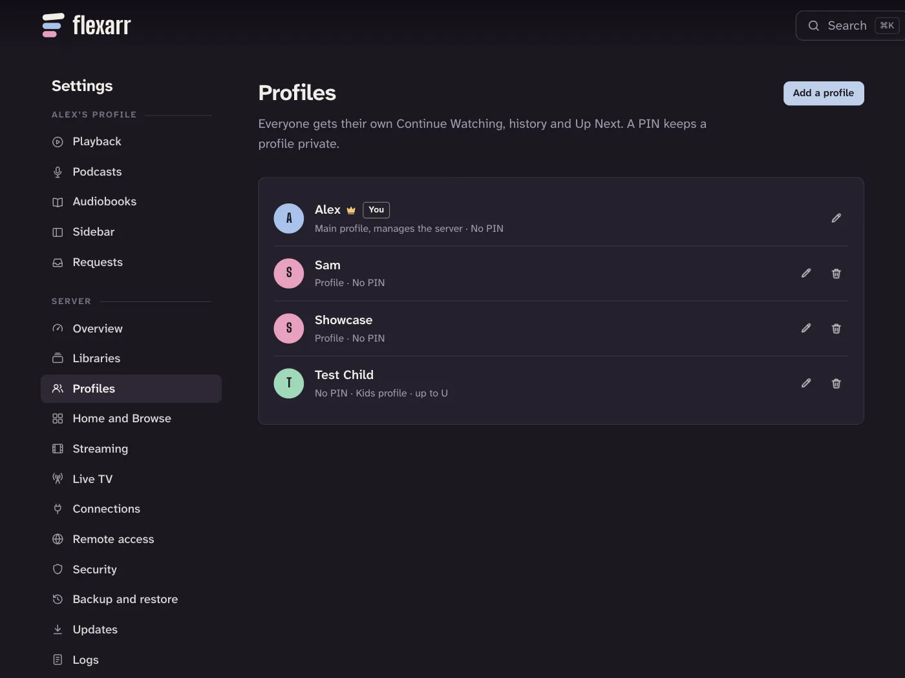

A profile is one person's view of Flexarr. Everyone in the household can have their own, so your half-watched film doesn't turn up in someone else's Continue Watching, and their cartoons don't fill your "Because you watched" row.

## What each profile keeps to itself

Each profile has its own:

- **Continue Watching**, watched history and Up Next
- **Playback settings**: auto-play the next episode, skip intros, recaps and credits, and subtitle size. These follow the profile to every device, the Apple TV included.
- **Podcasts**: the shows it follows, its Up Next queue and its podcast settings
- **Music**: playlists, daily mixes, and recently and most played
- **Collections** of its own (the main profile can also make collections for the whole household)
- **Live TV favourites** and the channel it watched last
- **Libraries**: which ones it can see at all (see below)
- A picture, a name and a colour

Things that belong to the server, such as your libraries, connections to Sonarr, Radarr and Lidarr, and the layout of Home, are the same for everyone.

## The main profile

The first profile, made when you set Flexarr up, is the **main profile**. It manages the server, and it has a crown beside its name in **Settings › Profiles** and on its picture when you choose who's watching.

Only the main profile can:

- change the server's settings, libraries and connections
- add, edit and remove profiles
- connect new devices, and see or replace the API key
- fix a wrong match, or delete a title through Sonarr or Radarr
- make and change the household's collections
- allow or block a title for kids, analyse a title, or scan a library for changes

Every other profile can browse, watch, listen, make requests through Seerr, and open **Settings** to change its own playback and podcast settings.

### Unlocking settings

Flexarr has an **admin PIN**: you choose it when you set Flexarr up. It belongs to the server, apart from the main profile's own PIN (see [PINs](#pins)). Watching as the main profile doesn't need it, and nor does tidying the library from a title's or library's page (the last three things above). Changing the server's settings, profiles and devices does. Open **Settings** on the main profile and the server's pages say **Settings are locked**: enter the admin PIN and choose **Unlock**.

Settings stay unlocked on that browser or device for 15 minutes after your last change. They lock again sooner if someone else is chosen there, if you choose **Lock settings** at the bottom of the list, or if the server restarts. Being on your home network doesn't skip the admin PIN.

A device asking to connect still shows up on the main profile while settings are locked. Choosing **Allow** asks for the admin PIN first.

If there's no admin PIN yet (a server set up before Flexarr asked for one), **Settings** asks you to choose one before anything else.

To keep the main profile's watch history private, give it a PIN of its own in **Settings › Profiles**, as for anyone. Choosing it then asks for that PIN; the admin PIN works there too.

## Adding a profile

On the web, signed in as the main profile:

1. Go to **Settings › Profiles** and choose **Add a profile**.
2. Give it a name, and if you like a picture and a colour.
3. Choose **Add a PIN** if it should be private.
4. Untick any libraries it shouldn't see.
5. Choose **Add profile**.

If you bring your history over from Plex, your Plex Home profile pictures can come too. See [Import from Plex](import-from-plex.md).

## PINs

A PIN is 4 to 8 digits. Without one, anyone can switch to that profile. With one, Flexarr asks for it whenever someone chooses the profile.

- The main profile's PIN works like anyone's: add it, change it or remove it in **Settings › Profiles**. It can be the same as the admin PIN or different.
- The admin PIN is in **Settings › Security**. It can be changed but not removed, and changing it takes the current one. If you've forgotten it, see [I forgot a profile's PIN](troubleshooting.md#i-forgot-a-profiles-pin).
- Without a PIN of its own, the main profile is chosen freely on browsers and devices you signed in. Someone coming in over Tailscale with their own account, or a browser at home that isn't signed in while there are kids profiles, is asked for the admin PIN instead, even when the main profile has a PIN of its own.
- Forgotten a profile's PIN? Choose **Forgot PIN?** under its PIN pad and enter the admin PIN: the PIN comes off, and you can give it a new one in **Settings › Profiles**.
- On a server from before the two were apart, the PIN you had became the admin PIN. The main profile kept it as its own too only if **Ask for the PIN when someone chooses the main profile** was on. Changing the admin PIN later doesn't change that one: change it in **Settings › Profiles** too.
- Wrong guesses lock out the device doing the guessing for a while, longer each time. Someone else guessing can't lock you out of your own profile.
- When wrong guesses at the admin PIN, or at the main profile's own, lock someone out, Flexarr notes it in its log and tells the main profile's phones (with notifications on), naming the device.

## Choosing which libraries a profile sees

When you have more than one library, each profile has a switch for each. A library that's switched off is hidden everywhere on that profile: Home, search, Discover, Coming soon and requests. Podcasts can be left out the same way.

## Age limits and kids profiles

### Age limits

Any profile except the main one can have an age limit, in **Settings › Profiles**: **U**, **PG**, **12**, **15** or **18**. Titles rated above it are hidden from that profile on every device: Home, the libraries, search, Continue Watching, the next episode, collections, Siri and notifications. Opening one by its link says it isn't there.

Ratings from any country count. An age is rounded up to the next UK step, so Germany's 16 counts as 18, and a few have a UK equivalent: PG-13 is 12, TV-14 is 15, and R and TV-MA are 18. A rating with its reasons ("Rated R for violence") counts by its first word. A show's seasons and episodes follow the show.

An age limit decides what a profile sees, not who can leave it: anyone can switch to another profile, with no PIN but that profile's own. To keep a child on kids profiles, turn on [Child lock](#child-lock).

A profile with an age limit:

- doesn't see titles without a rating, or music and home videos, which have none
- doesn't see Discover or Coming soon, can't make requests and can't add podcasts, since Flexarr can't tell the age of a title it hasn't got
- sees clean podcasts, but not episodes marked explicit
- sees only the Live TV channels you pick, and no recordings

### Letting things through, or keeping them out

- **A whole library:** switch on **Fine for kids** under it in **Settings › Libraries**. Everything in it shows, rated or not. Good for a folder of cartoons or family videos.
- **One film or show:** on its page, choose **⋯** then **Allow for kids** or **Block for kids**. Block wins even in a library that's fine for kids.
- **Live TV:** switch channels on under **Channels for kids** in **Settings › Live TV**. Until you pick some, a profile with an age limit doesn't see Live TV.

### Kids profiles

Switch on **Kids profile** for a child's profile (it comes on by itself for a new profile limited to U or PG). A kids profile:

- has no Settings, and no signing out on the web
- has no scores, no score-ranked rows such as Top 10, and a **Watch again** row on Home for the films and shows they've finished; on the web, bigger artwork too
- can't mark things watched, and has no trailers

Setting one up needs an admin PIN.

### Child lock

For the playroom TV or a child's tablet, turn on **Child lock**, so only kids profiles can be chosen on that device:

- **Web:** the profile menu, then **Child lock**.
- **Apple TV:** **Settings › Profiles**, or press and hold a kids profile in the profile picker.
- **iPhone, iPad and Android:** **Settings**, under **Watching as**, or hold the padlock on a kids profile's picture in the profile picker: child lock goes on with that profile.

Turning it on from the main profile takes no PIN (from any other profile, the admin PIN). To turn it off, hold the padlock in the profile picker (on Apple TV, press and hold the kids profile), or choose **Turn off child lock** in the web's profile menu, and enter the admin PIN. You can also turn it off for any device from **Settings › Security** on the web, which marks those with **Child lock on**.

Deleting the kids profile a device with child lock is on moves it to another kids profile. If it was the last one, turn off child lock first.

> **Note**
> Child lock needs the device's own sign-in: a browser signed in with the API key once, or an app connected with a code. An app still connected with the API key itself is the server, so kids profiles can't hold a child there at all: connect it again with a code. With **Only away from home** in **Settings › Security**, a browser at home that hasn't chosen a profile starts on a kids profile, and choosing the main profile there takes a PIN.

## Who's watching when Flexarr opens

When a household has more than one profile, Flexarr asks who's watching the first time a browser or device connects, and remembers the answer.

### On the web

The page is called **Choose a profile**. Profiles with a PIN say **Needs a PIN**. To switch later, open the menu under your profile picture at the top right and choose **Switch profile**. With two profiles, it says **Switch to** and the other person's name, and switches straight away unless that profile has a PIN. A non-main profile also has **Switch to the main profile** in Settings.

### On iPhone and iPad

Tap your picture on Home, or go to **Settings** and tap **Switch** beside your profile.

### On Apple TV

Who's watching is at the top of the sidebar, with your profile picture. Select it to switch. A profile with a PIN asks for it on an on-screen keypad.

An Apple TV in a shared living room can ask every time Flexarr opens, rather than opening as whoever watched last:

1. Open **Settings › Profiles** on the Apple TV.
2. Under **When Flexarr opens**, choose **Ask who's watching**.

Profiles with a PIN then ask for it every time too.

## Notifications and profiles

An iPhone or iPad gets notifications for one profile: whichever it was on when notifications were turned on. Switching profile on the phone doesn't change that, though **Settings › Notifications** offers to move them to the profile you're on now. See [Notifications and widgets](notifications-and-widgets.md).
