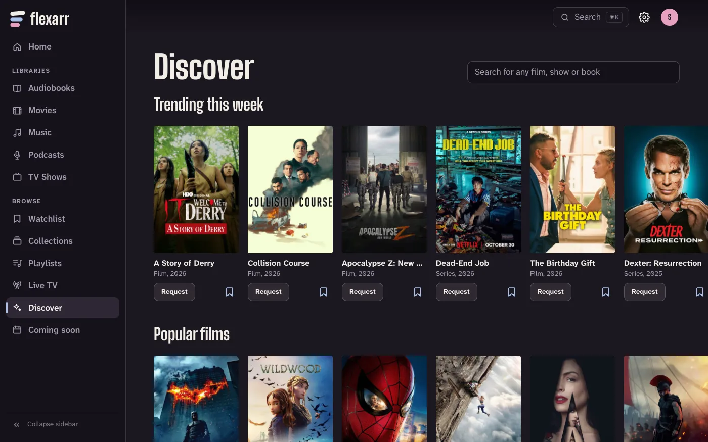

With Seerr connected, Flexarr can show you movies and shows you don't have yet, and request them in one go. Seerr passes the request to Radarr or Sonarr, they download it, and it turns up in your library.

Seerr, Overseerr and Jellyseerr all work.

## Before you start

Connect Seerr in **Settings › Connections**: under **Apps & Integrations**, choose **Connect** beside **Seerr**, type its **Address** (usually `http://<host>:5055`) and its **API key** (in Seerr, under **Settings › General**), and choose **Connect**. See [Connect Sonarr, Radarr, Lidarr and Seerr](connect-arrs.md).

Seerr itself needs Radarr and Sonarr set up in its own settings, since it hands requests to them. Connect Sonarr and Radarr to Flexarr too, so requested titles show up the moment they're downloaded (see [Webhooks](connect-arrs.md#webhooks-new-downloads-appear-straight-away)).

> **Note** Music is requested through Lidarr rather than Seerr: see [Music](#music). Audiobooks aren't requested.

## Where you can request

| Where | Discover | Request |
| --- | --- | --- |
| Web app | Yes | From Discover, search, collections and a show's page |
| Apple TV | Yes | From Discover, search and a show's page |
| iPhone and iPad | No | From **Search** and a show's page |
| Android and Android TV | Android TV only | From **Search** and a show's page (and Discover on Android TV) |

## On the web

Choose **Discover** in the sidebar. With Seerr connected, it starts with rows from Seerr:

- **Trending this week**
- **Popular movies**
- **Popular new shows**
- **Coming to cinemas**

Below them is **Your library by genre**, which is everything you already have.

Each poster is marked if you already have it or it's already been asked for. For anything else, choose **Request** under the poster, or open it to see more about it first and choose **Request** there.

### Search for anything

The search box at the top of Discover, **Search for any movie or show**, looks beyond your library. Type a title and you get every matching movie and show, with the ones you already have marked. Request anything else from the results.

The search box at the top of every page (⌘K) looks beyond your library too: once you stop typing, movies, shows, artists and albums you don't have are listed last, under **Not in your library**. Pick one to open its page and request it there.

### Missing movies in a collection

A movie series collection lists the movies you don't have under **Not in your library**, each with its own **Request** button.

### Missing seasons and episodes

A show's page, below its seasons, lists what you don't have under **Not in your library**, in every app:

- **Seasons** you have none of, each with **Request**. That asks Seerr for just that season, not the whole show again.
- **Episodes** missing from seasons you have some of. The main profile can choose **Search** to have Sonarr look for a season's missing episodes.

Above it, **Coming up** lists the next episodes Sonarr expects, with the day each airs. A season tab that's short of what has aired says so, such as **8 of 10**. Episodes come from Sonarr; a show Sonarr doesn't manage lists whole seasons from Seerr instead. Specials aren't listed, and kids profiles don't see any of this.

## On the Apple TV

**Discover** is in the sidebar, above **Search**. It shows the same rows as the web: what's trending, popular movies, popular new shows, and what's coming to cinemas.

1. Select a title you don't have to open it. You'll see its IMDb and Rotten Tomatoes scores, cast, who made it, and more like it.
2. Select **Request**.
3. Press **Menu** to go back to Discover.

A title you already have is marked with a gold play badge on its poster, and opens as itself.

**Search**, at the top of Discover next to **Browse**, finds any movie or show, not only what's in your library, so you can request it from there. The main **Search** lists movies, shows, artists and albums you don't have in a row of their own, **Not in your library**.

Without Seerr connected, Discover on the Apple TV shows your library by genre, and says where to connect Seerr.

## On iPhone and iPad

With Seerr connected, **Search** looks beyond your library too. Movies and shows you don't have are listed under **Not in your library**. Tap one to open its page: its scores, cast and trailer, with **Request** and **Watchlist**. Once it's asked for, it's marked **Requested**. Android phones work the same way.

## Who can request

Any profile can request, with two exceptions. Kids profiles, and any profile with an age limit, can't request at all. A profile that can't see any of your movie libraries can't request movies, and one that can't see any TV libraries can't request shows. Libraries a profile sees are set in **Settings › Profiles**. Hidden libraries are left out of Discover and requests for that profile too. See [Profiles](profiles.md).

Flexarr sends every request to Seerr with its own API key. Seerr doesn't know which profile asked: it handles the request under the rules of the Seerr account that key belongs to, which decides whether it's approved automatically. Shows are requested with all their seasons, except a season requested from a show's page, which is requested on its own.

## Where requests go

With two or more TV or movie libraries Seerr can add to, the main profile chooses which one each profile's requests land in, by editing the profile in **Settings › Profiles**: **New shows go to** and **New movies go to**. When two people have a TV library each, the shows each of them asks for go to their own. The choice applies to requests from every device. With one library of each kind there's nothing to choose.

## Status and when it arrives

A title's button changes to show where it stands:

| You see | What it means |
| --- | --- |
| **Request** | Not in your library and not asked for. |
| **Requested** | Seerr has it. Radarr or Sonarr will download it when they find it. Press it to take the request back. |
| **Partly in your library** | Some of it is here already, such as some seasons of a show. |
| **In your library** | You have it. |
| **Can't request** | Seerr or Sonarr can't take it, and says why (a show TheTVDB doesn't list, for example). |
| **Try again** | The request didn't go through. Press it to ask again. |

If Seerr is connected but isn't answering, the buttons are greyed with **Seerr isn't answering** until it's back.

### Taking a request back

Press **Requested** to take a movie or show back. It asks first, then **Unrequest** does it for the whole household, as Seerr is shared: Seerr forgets the request, Radarr or Sonarr stop looking for it and cancel its download, and a title with nothing downloaded yet is taken out of them. Nothing on disk is deleted, and a show you have some of keeps the seasons you have. On a show's page, a requested season under **Not in your library** can be taken back on its own. On iPhone and Android, **Not in your library** results in Search offer **Unrequest** in their press-and-hold menu too. Family guests can ask for a title but can't take one back.

Flexarr remembers who asked for what. When the movie or show arrives, whoever requested it gets a **Your request is ready** notification on their iPhone or iPad, if notifications are on for that profile. See [Notifications and widgets](notifications-and-widgets.md).

To follow a request while it downloads, open the library's **Requested** view on the web (below), or **Coming soon** in Flexarr's sidebar for what Sonarr and Radarr are expecting.

On the web, Movies and TV libraries have a **Requested** view: every movie or show asked for through Seerr (in Flexarr or in Seerr itself) that's on its way to that library and isn't in yet. Each says **Searching**, **Downloading** with how far it's got, **Importing**, or **Out** and its date. A show lists the seasons asked for. **Unrequest** takes one back.

## Music

Seerr doesn't do music, so music requests go straight to Lidarr. With Lidarr connected, you can find artists and albums you don't have and add them.

**Before you start:** connect Lidarr in **Settings › Connections** (see [Connect Sonarr, Radarr, Lidarr and Seerr](connect-arrs.md)). **Music requests** is on below Lidarr there; turn it off to keep Lidarr connected without anyone requesting music. Lidarr needs a root folder, an indexer and a download client of its own.

Suggestions and charts come from Deezer, which needs no account. Requests use Lidarr's own search, which looks artists and albums up on MusicBrainz.

| Where | Find music |
| --- | --- |
| Web app, Apple TV and Android TV | **Discover**, then **Music** |
| iPhone, iPad and Android phones | **Search**, under **Not in your library** |
| Every app | An artist's page in your music library |

**Discover › Music** has these rows:

- **Like artists you play**: artists like the ones you listen to most.
- **New from your artists**: this year's releases by artists you have, that you don't have yet.
- **Top albums**: what's charting now.

Below them are genres. Each one opens its best-known artists.

There are two kinds of music request:

- **Request album** downloads that album and nothing else. If Lidarr doesn't have the artist yet, it adds them without their other albums.
- **Follow** downloads the artist's latest album now, then each new release as it comes out. Their older albums are still requested one at a time. A followed artist joins your library's **Artists** straight away, even before any of their music arrives.

Press **Following** or **Requested** to take it back. **Stop following** stops Lidarr looking for the artist's new albums (anything already asked for still downloads). **Unrequest** stops Lidarr wanting the album and cancels its download. Both are for the whole household, as Lidarr is shared. Family guests can ask for music but can't take it back.

If Lidarr can't find an album or artist (it only knows what's listed on MusicBrainz), the button says **Can't request** and why.

An artist's page in your library ends with **Not in your library**: the albums of theirs you don't have, each with **Request album**. Below that, **Fans also like** suggests artists like them.

When an album you asked for arrives, you get a **Your request is ready** notification. Each time an artist you follow puts out a new album, you get **New from** the artist.

An album someone in the household asked for shows **Requested** to everyone for two weeks. If it still hasn't arrived by then (Lidarr couldn't find a copy), it can be asked for again, which has Lidarr search again. Each profile can ask for up to 30 albums and follows a day.

The same profiles can request music as can request movies and shows. Kids profiles, profiles with an age limit and profiles that can't see a music library can't. Requests only go to music libraries the profile can see. With two or more of them that Lidarr adds to, **New music goes to** in the profile's settings picks which one gets the profile's requests.

### On its way

On the web, a music library's **Requested** view lists every album Lidarr is waiting for with that library's artists: albums anyone asked for, and new releases by artists you follow, with when they're out. Each says **Searching**, **Downloading** with how far it's got, **Importing**, or **Out** and its date. **Unrequest** takes one back.

Without Lidarr, there's no Discover › Music, Follow, Request or Requested. If Lidarr is connected but isn't answering, the buttons are greyed with **Lidarr isn't answering** until it's back.

## If requests don't work

- **Discover has no Seerr rows:** check Seerr shows a green dot in **Settings › Connections**. If it says it can't be reached, or the API key isn't right, edit it there.
- **"Requests need a Seerr server":** Seerr isn't connected yet.
- **"This profile can't request movies" (or shows):** that kind of library is hidden from the profile you're using.
- **"Seerr didn't accept the request":** it may already be requested, or Seerr turned it down. Seerr's own requests page says why.
- **"Lidarr doesn't know" an artist or album:** Lidarr's search couldn't find it on MusicBrainz, or found more than one artist with that name. Add it in Lidarr itself.
- **"Lidarr didn't take the request":** Lidarr isn't reachable, or turned the request down. Lidarr's **Activity** page says why.
