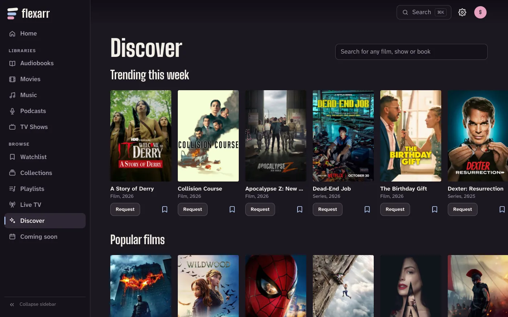

With Seerr connected, Flexarr can show you films and shows you don't have yet, and request them in one go. Seerr passes the request to Radarr or Sonarr, they download it, and it turns up in your library.

Seerr, Overseerr and Jellyseerr all work.

## Before you start

Connect Seerr in **Settings › Connections**: under **Apps & Integrations**, choose **Connect** beside **Seerr**, type its **Address** (usually `http://<host>:5055`) and its **API key** (in Seerr, under **Settings › General**), and choose **Connect**. See [Connect Sonarr, Radarr, Lidarr and Seerr](connect-arrs.md).

Seerr itself needs Radarr and Sonarr set up in its own settings, since it hands requests to them. Connect Sonarr and Radarr to Flexarr too, so requested titles show up the moment they're downloaded (see [Webhooks](connect-arrs.md#webhooks-new-downloads-appear-straight-away)).

> **Note** Seerr requests are for films and shows. In the next release, audiobooks can be requested through Readarr, Bookshelf or Chaptarr: see [Audiobooks](#audiobooks). Music isn't requested.

## Where you can request

| Where | Discover | Request |
| --- | --- | --- |
| Web app | Yes | From Discover, its search and collections |
| Apple TV | Yes | From Discover and its search |
| iPhone and iPad | No | From **Search** |

## On the web

Choose **Discover** in the sidebar. With Seerr connected, it starts with rows from Seerr:

- **Trending this week**
- **Popular films**
- **Popular new shows**
- **Coming to cinemas**

Below them is **Your library by genre**, which is everything you already have.

Each poster is marked if you already have it or it's already been asked for. For anything else, choose **Request** under the poster, or open it to see more about it first and choose **Request** there.

### Search for anything

The search box at the top of Discover, **Search for any film or show**, looks beyond your library. Type a title and you get every matching film and show, with the ones you already have marked. Request anything else from the results.

### Missing films in a collection

A film series collection lists the films you don't have under **Not in your library**, each with its own **Request** button.

## On the Apple TV

**Discover** is in the sidebar, above **Search**. It shows the same rows as the web: what's trending, popular films, popular new shows, and what's coming to cinemas.

1. Select a title you don't have to open it. You'll see its ratings, cast, who made it, and more like it.
2. Select **Request**.
3. Press **Menu** to go back to Discover.

A title you already have is marked with a gold play badge on its poster, and opens as itself.

**Search**, at the top of Discover next to **Browse**, finds any film or show, not only what's in your library, so you can request it from there.

Without Seerr connected, Discover on the Apple TV shows your library by genre, and says where to connect Seerr.

## On iPhone and iPad

With Seerr connected, **Search** looks beyond your library too. Films and shows you don't have are listed under **Not in your library**. Tap one and choose **Request**. Once it's asked for, it's marked **Requested**.

## Who can request

Any profile can request, with two exceptions. Kids profiles, and any profile with an age limit, can't request at all. A profile that can't see any of your film libraries can't request films, and one that can't see any TV libraries can't request shows. Libraries a profile sees are set in **Settings › Profiles**. Hidden libraries are left out of Discover and requests for that profile too. See [Profiles](profiles.md).

Flexarr sends every request to Seerr with its own API key. Seerr doesn't know which profile asked: it handles the request under the rules of the Seerr account that key belongs to, which decides whether it's approved automatically. Shows are requested with all their seasons.

## Where requests go

With two or more TV or film libraries Seerr can add to, the main profile chooses which one each profile's requests land in, by editing the profile in **Settings › Profiles**: **New shows go to** and **New films go to**. When two people have a TV library each, the shows each of them asks for go to their own. The choice applies to requests from every device. With one library of each kind there's nothing to choose.

## Status and when it arrives

A title's button changes to show where it stands:

| You see | What it means |
| --- | --- |
| **Request** | Not in your library and not asked for. |
| **Requested** | Seerr has it. Radarr or Sonarr will download it when they find it. |
| **Partly in your library** | Some of it is here already, such as some seasons of a show. |
| **In your library** | You have it. |
| **Try again** | The request didn't go through, perhaps because it's already been requested. |

Flexarr remembers who asked for what. When the film or show arrives, whoever requested it gets a **Your request is ready** notification on their iPhone or iPad, if notifications are on for that profile. See [Notifications and widgets](notifications-and-widgets.md).

To follow a request while it downloads, use Seerr itself, or **Coming soon** in Flexarr's sidebar for what Sonarr and Radarr are expecting.

## If requests don't work

- **Discover has no Seerr rows:** check Seerr shows a green dot in **Settings › Connections**. If it says it can't be reached, or the API key isn't right, edit it there.
- **"Requests need a Seerr server":** Seerr isn't connected yet.
- **"This profile can't request films" (or shows):** that kind of library is hidden from the profile you're using.
- **"Seerr didn't accept the request":** it may already be requested, or Seerr turned it down. Seerr's own requests page says why.

## Audiobooks

Book requests arrive in the next release, on the web only. Seerr doesn't handle books, so Flexarr asks Readarr, Bookshelf or Chaptarr itself. Connect one in **Settings › Connections**, then under **Requests** in **Settings › Libraries** switch on **Book requests (preview)** and choose its **Quality**, **Metadata** and **Folder**.

> **Note** Book requests are a preview, off to start with. Bookshelf, the Readarr fork most people run, can't always search by title: its searches go to Goodreads, which often doesn't answer. Typing a book's ISBN works better. Coming soon, new books arriving and deleting through the app work whether requests are on or not.

In Discover's search, **Search for any film, show or book**, find a book you don't have and choose **Request**. Each result says whether it's **In your library**, **Requested** or available to request. Flexarr adds the book (and its author, if they're new, without following their other books), then asks for it to be found. When it arrives, whoever asked hears that it's ready to listen.

With more than one audiobooks library, the main profile chooses where each profile's books go with **New books go to**, in the profile's editor in **Settings › Profiles**.

