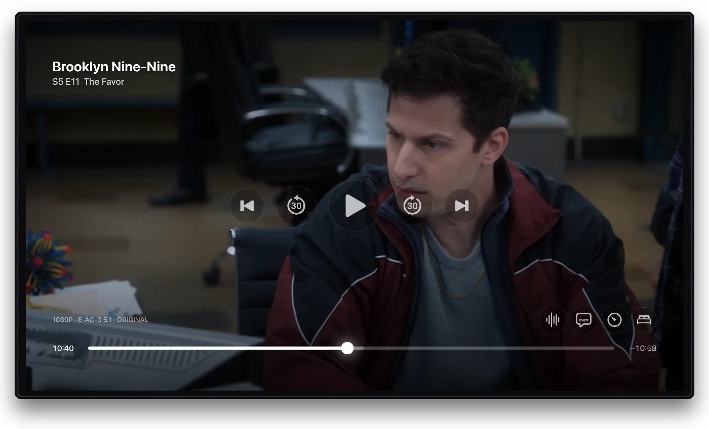

Flexarr's own player on Apple TV, iPhone and iPad, and the web player, share the same features for subtitles and getting through a series. Your choices belong to your [profile](profiles.md), so they follow you from the TV to your phone.

## Subtitles

### What Flexarr finds

Flexarr picks up two kinds of subtitles:

- **Embedded:** tracks inside the video file, as most MKV files have.
- **Sidecar files:** `.srt`, `.vtt`, `.ass` or `.ssa` files beside the video, named after it. Add a language and, if you like, `forced` or `sdh` before the extension:

```text
Heat (1995).mkv
Heat (1995).en.srt
Heat (1995).en.sdh.srt
Heat (1995).en.forced.srt
```

Sonarr, Radarr and most subtitle tools name files this way already.

Subtitles come as **text** (SRT, WebVTT, ASS and the like) or **pictures** (PGS from Blu-rays, VobSub from DVDs, DVB from broadcasts). Text subtitles are drawn by the player at the size you choose. Picture subtitles are drawn by the app on Apple TV, iPhone and iPad when **Play files directly** is on. In a web browser they have to be burned into the picture, which means the server converts the video while they're on.

> **Note**
> Styled ASS subtitles show their words but not their fonts, colours or positions yet.

### Finding subtitles

When a film or episode has no subtitles in your language, or the ones it has are out of time, Flexarr can fetch some through [Bazarr](connect-arrs.md#bazarr). It works for what Sonarr and Radarr manage, in the languages Bazarr is set up for, and every profile can use it.

1. In the player, open the subtitles menu and choose **Search for subtitles…**. On a title's page in the web app, it's under **⋯**.
2. Wait while Bazarr asks its subtitle sites. It can take a minute.
3. Choose one and **Download**, or **Pick the best for me**. Those marked **Matches your file** were made for your exact copy, so they should be in time.

The subtitles are saved beside the video, so every app sees them. In the player, the title carries on where it was with them on.

If subtitles beside the video drift out of time, choose them, then **Re-sync to audio**. Bazarr lines them up with the soundtrack, which takes a minute or so, and the player picks up the new timing when it's done. For an offset that's the same all the way through, **Timing** in the subtitles menu is quicker.

### Turning them on and off

Choose a subtitle track, or **Off**, from the subtitles menu in the player. Flexarr remembers your choice for that film or show, so the next episode and the next sitting start the same way. That includes Off. The same goes for the audio track: pick another language once and the rest of the series follows.

**Forced** subtitles, the ones that translate the odd line of foreign dialogue, come on by themselves when they match the soundtrack's language. They don't count as you choosing subtitles, so the full subtitles won't switch themselves on next time.

### Size

Choose **Small**, **Standard**, **Large** or **Extra large**. It's your profile's setting on every device:

- On the web, in **Settings › Playback › Subtitle size**, or the player's subtitles menu.
- On Apple TV, in **Settings › Playback › Subtitle size**, or the player.
- On iPhone and iPad, in **Settings › Playback**.

### Timing

If subtitles come too early or too late, move them to match the speech. In the web player, use the subtitles menu, a quarter of a second at a time. On Apple TV, it's in the subtitles button in the player's bar. Each film or episode remembers its own timing. Timing can't be adjusted on iPhone or iPad yet.



## Skipping intros, recaps and credits

### How Flexarr finds them

Flexarr looks for intros, recaps and credits in two ways:

1. **Chapter names.** If a file has chapters called "Intro", "Opening", "Recap", "Previously" or "Credits", Flexarr uses them. This is the only way it finds recaps, and the only way it finds credits in films.
2. **Audio fingerprinting.** For episodes without useful chapters, Flexarr listens to each episode of a season and compares it with the episodes either side. A theme tune and credits music repeat while everything else changes, so the shared stretch is the intro or the credits. A season needs at least two episodes for this to work.

Opening credits early in an episode count as an intro to skip, not as the end of the episode.

### When markers are ready

The analysis runs in the background while the server is quiet, a season at a time. When someone starts watching a season that hasn't been analysed yet, that season jumps the queue, so skipping is usually ready by the next episode. **Settings › Overview** shows how far it has got under **Background work**.

The player's timeline shades the intro and credits once they're known.

### Skip buttons, or skipping by itself

By default, a **Skip Intro** button appears when an intro starts. To skip without pressing anything, turn these on in **Settings › Playback** on any device, or from the player's menu on the web:

- **Skip intros**: jumps past the opening titles.
- **Skip recaps**: jumps past "Previously on…".
- **Skip credits**: moves on to the next episode as the credits start, rather than when they end.

They're your profile's own, on every device.

## Up Next

When an episode ends, a five-second countdown starts the next one. Press **Cancel** to stop it. Flexarr gets the next episode ready while the credits play, so it starts straight away. If the server is busy with other people's streams, it starts the usual way instead.

Turn the countdown off with **Auto-play the next episode** in **Settings › Playback**. If you watch a special in the middle of a season, Up Next carries on with the regular episodes afterwards. When you're shuffling a show, the countdown plays another random episode.

The player also has previous and next episode buttons.

## Scrubbing previews

Drag along the timeline and small pictures show where you'll land. Flexarr makes these the first time a file is played, so on a film's very first viewing they may not be there yet.

On Apple TV, hold the left or right of the remote's touch surface to scan at 2×. Each further click doubles the speed, up to 16×. The other side turns it round, and Select lands.
