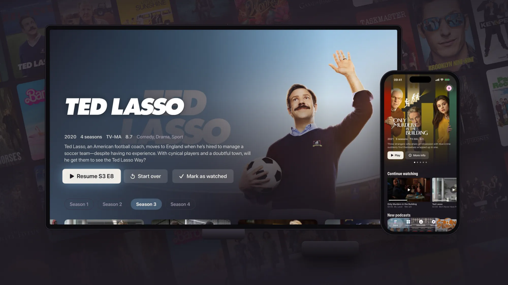

Flexarr comes in two halves. The **server** runs on a computer in your home and keeps your films, TV shows, music and podcasts. The **apps** on your iPhone, iPad, Apple TV and web browser connect to it and play from it. There's no account and no cloud service in the middle: your library stays on your own disk.

If you've installed the iPhone app and it sent you here, this is the part you're missing. Set up the server once, then connect your phone to it with a short code.

Flexarr is free for personal and other noncommercial use under the [PolyForm Noncommercial licence](https://github.com/danleach-glitch/flexarr/blob/main/LICENSE).

## A computer that stays on

The server needs a machine that's switched on whenever you want to watch. Any of these work:

- **A Mac**, Apple silicon or Intel. Flexarr runs on it natively and uses the Mac's graphics chip to convert video.
- **A NAS** that runs containers, such as a Synology or an Unraid server.
- **A Linux box or mini PC** with Docker. That includes a Raspberry Pi 5 running a 64-bit operating system.
- **A Windows PC** with Docker Desktop.

The Docker image is built for both 64-bit Intel/AMD (`amd64`) and 64-bit ARM (`arm64`) processors. There's no 32-bit build, and no native Windows or Linux download: on those, Docker is the way in.

### Disk space

Your media takes whatever it takes. Flexarr itself needs room for its database and a cache of artwork, subtitles, scrubbing previews and video it's converting at the moment. Leave a few gigabytes free on the drive that holds Flexarr's settings folder, more for a large library.

### Processor and hardware transcoding

Most of the time Flexarr sends files as they are. The iPhone, iPad and Apple TV apps play files directly by default, HDR and Dolby Vision included, so the server does little more than read from disk.

The server converts (transcodes) video when a device can't play a file as it is: a web browser meeting a format it doesn't know, a stream limited to a lower quality for watching away from home, or some downloads. Converting is hard work for a processor, so this is where the machine matters:

- **On a Mac**, Flexarr uses Apple VideoToolbox automatically. Any recent Mac copes well.
- **In Docker**, Flexarr converts on the processor unless you choose hardware acceleration in **Settings › Streaming**, which lists only what the server's FFmpeg supports. See your platform's install page for what's available there.

A modest machine is fine if you mostly watch on Apple devices at home. If you plan to stream to browsers or over a slow connection a lot, a faster processor (or a Mac) helps. Flexarr converts at most three videos at once by default and tells anyone beyond that the server is busy, rather than slowing everybody down.

## Do you need Sonarr, Radarr and Lidarr?

Flexarr is built to sit alongside Sonarr (TV), Radarr (films), Lidarr (music) and Seerr (requests). It doesn't download anything itself, and it takes its titles, artwork and details from those apps rather than asking you for API keys to online databases.

You can run Flexarr without them, but what you get differs by library.

| Library | With the app | Without it |
| --- | --- | --- |
| Films | Radarr supplies titles, posters, backgrounds, overviews, genres, ratings, trailers and cast. Films Radarr doesn't manage are looked up through its search. | Films are found and play, named from their folders and files, but have no artwork or details. |
| TV shows | Sonarr supplies show and episode details and artwork. Flexarr adds cast from TVmaze. | Episodes are found and play, organised from names like `S01E02`, but have no artwork or details. |
| Music | Lidarr adds artist pictures, album details and sorts albums, EPs and singles apart. | Works well: Flexarr reads the tags in your files and uses `cover.jpg` or `folder.jpg` images, or art embedded in the files. |
| Requests | Seerr lets you search for and request films and shows from the web app and the Apple TV. | No requests. |

A few other things depend on the \*arrs too:

- **New downloads appear straight away** when Sonarr, Radarr or Lidarr tell Flexarr about them with a webhook. Without that, Flexarr finds new files on its own scan, every 12 hours, or when you start one in **Settings › Libraries**.
- **Coming soon**, showing episodes about to air and films about to be released, comes from Sonarr and Radarr.

Some features don't need any of them: podcasts are built in, [Live TV](live-tv.md) uses Dispatcharr, and the web app, profiles, downloads to your phone and [importing your history from Plex](import-from-plex.md) all work on their own.

> **Tip** If you don't run the \*arrs yet, you can start with Flexarr and a folder of media, then add Sonarr and Radarr later. Flexarr tries unmatched titles again within a day, or straight away when you choose **Refresh artwork and details** on a library in **Settings › Libraries**.

> **Note** Seerr only adds requests. Flexarr talks to Sonarr, Radarr and Lidarr directly for everything else.

## The apps

- **iPhone and iPad**: [on the App Store](https://apps.apple.com/app/flexarr/id6826618084).
- **Apple TV**: coming soon to the App Store. Until then you can [install it from Xcode](apple-tv-xcode.md).
- **Web**: built into the server. Open the server's address in any browser.

## Pick your platform

- [Install on a Mac](install-macos.md)
- [Install on a Synology NAS](install-synology.md)
- [Install on Unraid](install-unraid.md)
- [Install with Docker on Linux or Windows](install-docker.md)
